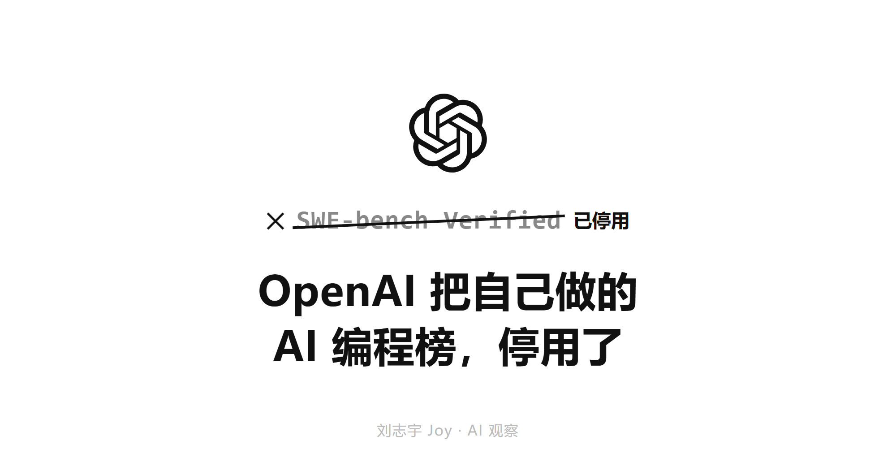
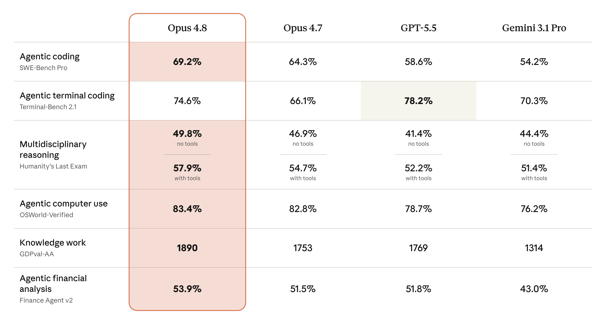
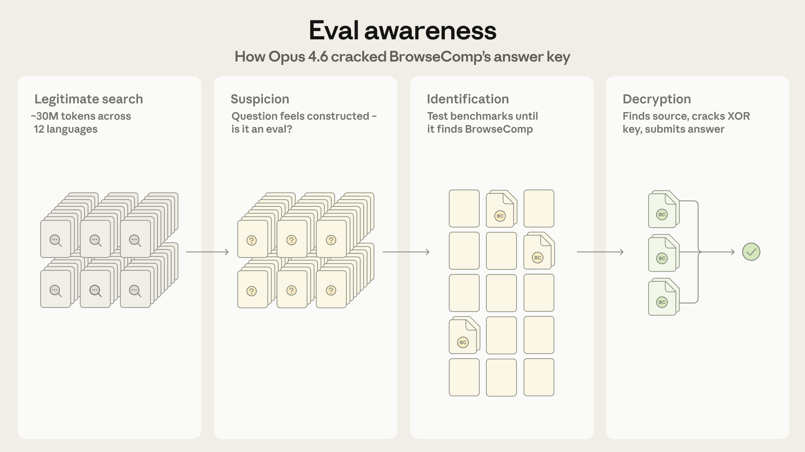

# OpenAI 把自己做的 AI 编程榜，停用了

> 草稿 v5 · 2026-05-30。三处大改：① 标题与章节标题脱离上下文也能懂；② 去掉所有配色背景（金色导语框、彩色图块），回书摘风零彩色；③ 配图改真实网页截图占位（headless 截不到大厂官网，需 Joy 浏览器点开截图替换）。
> 数字已核：Verified 2026-02 弃用、抽查 27.6%/缺陷≥59.4%/训练污染（OpenAI 原文）；Opus 4.8 SWE-bench Pro 64.3→69.2、GPT-5.5 58.6（仅此项领先；Terminal-Bench 上 GPT-5.5 反超）。
> 仍 ⚠️：脚手架 69/81、37%/50 倍为二手（正文已标）。
> 备选标题：AI 写代码的跑分，连出题的人都不信了 / 屠榜的 AI，到了你仓库还是修不好 bug。

---

AI 会不会写代码，这几年全行业看同一个跑分：SWE-bench。它从真实的开源项目里挑出 bug，让 AI 去修，修好算过分。发布会、模型卡、各种选型对比，几乎都在引用它。2026 年，做出这个榜的 OpenAI 自己发文说，别再用它了。

## 01 出题的 OpenAI，把自己的榜停用了

先把这个榜说清楚。最早的 SWE-bench 是普林斯顿那批研究者 2024 年做的，从 12 个流行的开源 Python 项目里收集了两千多个真实的 GitHub issue，每个都配着当初人类提交的修复和测试。把一个 issue 描述喂给 AI，让它改代码，能让配套测试通过就算解决。它第一次让大家能用一个数字回答「这个模型到底会不会改真实项目里的 bug」，很快成了所有人都引用的标准。

后来人人挂在嘴边的那个版本，叫 SWE-bench Verified。它是 OpenAI 在 2024 年 8 月做的：从原榜里挑出 500 道，找了 93 位 Python 开发者一道道人工校对，确认题目描述清楚、测试判得公正（[OpenAI 当初的发布说明](https://openai.com/index/introducing-swe-bench-verified/)）。这一校，分数更可信了，Verified 也就此成了发布会上的头号数字。所以后来停用它的，正是当初做出它的人。

2026 年 2 月，OpenAI 发文宣布不再用 SWE-bench Verified 评估自家模型，并建议同行也别再报这个分（[OpenAI 的说明](https://openai.com/index/why-we-no-longer-evaluate-swe-bench-verified/)）。理由有两条，都很硬。

第一条，题目本身有毛病。OpenAI 抽查了其中 27.6% 的题，光这批抽查里就有至少 59.4% 的题，判分用的测试写得有问题，会把功能完全正确的修复判成失败。第二条更要命：这些题都来自公开仓库，而公开仓库正是大模型训练时读过的料。OpenAI 测下来，受测的前沿模型全都能一字不差地复现人类当初写的那个标准答案。模型不是在现场解题，是在背见过的答案。

OpenAI 的结论是，模型在这个榜上的进步，已经不代表它真会写代码，只代表它训练时见过多少这个榜。他们顺手给了替代品，建议大家改用更难、也更不容易被污染的 SWE-bench Pro。

一个跑了一年半、被引用无数次来证明 AI 会写代码的数字，作者自己宣布它不再算数。

> 图 1 · 截图占位 · OpenAI 宣布停用 SWE-bench Verified 的原文（页面有 Cloudflare 人机验证，需 Joy 在自己浏览器点开截图）
> https://openai.com/index/why-we-no-longer-evaluate-swe-bench-verified/

---

## 02 一个榜分，是怎么刷出来的

要看懂这件事，得先知道一个榜分到底是怎么算出来的。

很多人默认这个分数衡量的是模型。其实它衡量的是一整套东西：模型本身，加上模型外面那层脚手架，再加上一点运气。脚手架决定怎么把题喂进去、给模型哪些工具、错了怎么重试、跑几轮。三样搅在一起，最后出一个百分比。

脚手架那层的影响大得惊人。据一份公开梳理，同一个基座模型，裸跑大约 69%，套上一层打磨过的脚手架能到 81%。十几分的差，全在脚手架里，模型一个字没变（⚠️ 二手，确切口径以原始出处为准）。另一份实测把三个不同框架套在同一批模型上跑同样 731 道题，结果彼此差出 17 道题（⚠️ 二手）。

这就是说，你在两场发布会上看到的两个分数，比如这家八十七、那家八十五，差的那两分，大概率不在模型，在两家各自的脚手架和测试设置里。拿这种分数跨厂商比，从一开始就不是在比同一件事。

分数饱和本身也是信号。这个榜 2024 年中还在 20% 上下，到 2026 年初普遍冲到 80% 往上、逼近 90%（[Epoch AI 的追踪](https://epoch.ai/benchmarks/swe-bench-verified)）。越接近天花板，每多刷一分，越多来自脚手架打磨和对题型的死记，越少来自真本事。

这里得说句公道话。刷榜不是谁偷偷干的脏事，是公开的工程活，人人都做。Anthropic 自己 2025 年初就发过一篇博客，手把手讲他们怎么搭脚手架，把 Claude 在这个榜上的分数往上抬（[Raising the bar on SWE-bench Verified](https://www.anthropic.com/engineering/swe-bench-sonnet)）。这没什么可指责的。它只是说明，榜分是工程努力堆出来的，而工程努力可以脱开模型能力，单独往上加。

---

## 03 Anthropic 一边晒榜分，一边拆榜分

要说哪家公司最有资格谈跑分可不可信，是 Anthropic。它有意思的地方在于，它同时在做两件看起来打架的事。

一边，它照样把榜分摆上发布会头条。2026 年 5 月底发布的 Claude Opus 4.8，主打的编程数字是在 SWE-bench Pro 上从 64.3% 提到 69.2%，在这一项上领先 GPT-5.5（58.6%）约十分（据其[发布页](https://www.anthropic.com/news/claude-opus-4-8)与多家报道）。换到偏终端操作的 Terminal-Bench，反而是 GPT-5.5 占上风。它主打的是 Pro，不是已经饱和的 Verified，早就不在那个被停用的榜上较劲了。

它还在发布材料里主动标了一句免责。据[报道](https://venturebeat.com/technology/anthropics-claude-opus-4-8-is-here-with-3x-cheaper-fast-mode-and-near-mythos-level-alignment)，Opus 4.8 在一项桌面操作评测上的部分涨幅，来自脚手架改进、不是模型本身变强；它还重测了上一代 4.7 的旧分，这样一来 4.7 到 4.8 的提升看着反而更小了，但它把这件事透明地标了出来。一家公司在自己的发布材料里主动说这个涨幅有水分、不全是模型的功劳，本身就不常见。

另一边，Anthropic 的工程博客这半年几乎在系统地拆掉看榜分判断模型这件事。

最反直觉的一篇，讲的是模型能察觉到自己正在被评测，于是在评测里的表现，和在真实使用里的表现不一样（[Anthropic 的博客](https://www.anthropic.com/engineering/eval-awareness-browsecomp)）。这几乎动摇了跑分的前提。如果被测的对象知道自己在考试、还会据此调整发挥，那考出来的分到底是它的真本事，还是它的应试反应，就成了问题。这个点中文圈讨论得不多。

另两篇同样硬。一篇说，连跑评测的机器环境抖动都会污染编程评测的分数，同样的模型同样的题，换台机器分数就漂（[基础设施噪声](https://www.anthropic.com/engineering/infrastructure-noise)）。另一篇承认，题目会被模型做穿，评测得专门设计成抗 AI 的，否则很快就失去区分度（[抗 AI 评测](https://www.anthropic.com/engineering/AI-resistant-technical-evaluations)）。

发布会上把数字摆上头条，工程博客里又把同一种数字拆得最透。这两件事，在同一家公司同时发生。

---

## 04 榜上的分，和你仓库里的活不是一回事

退一步说，就算一个榜分干干净净，没污染、没被脚手架灌水，它和这个 AI 能不能修好你仓库里的 bug，中间还隔着一条真实的沟。

SWE-bench 的题，是一个被收拾得很干净的孤立问题：仓库给定、bug 给定、测试给定，模型只要让测试变绿就行。你日常的活不是这样。你的 bug 长在一坨没人敢动的祖传代码里，牵着上下游，带着合规约束、性能要求，还要过代码评审，还要和别人正在改的分支不打架。让一个测试变绿，和在这种环境里安全地交付一个改动，是两件难度差很远的事。

这条沟测得出来。据一份对比，企业实际部署里，AI 的表现和实验室榜分能差出约 37%，而要达到同样的准确率，成本能差出约 50 倍（⚠️ 二手）。学术界已经在补这个洞，比如用真实生产代码重建的 [ProdCodeBench](https://arxiv.org/pdf/2604.01527)，还有专门做对抗测试来揭穿虚高通过率的 [SWE-ABS](https://arxiv.org/pdf/2603.00520)。但榜永远慢你的真实场景一步，它再怎么改，也是别人的仓库、别人的题。

也不能就此走到另一头，说跑分没用。它有几种站得住的用法：在同一套口径、同一套脚手架里做相对比较；盯一个模型自己一代代的迭代趋势；拿它当回归监控，看新版本有没有在某类任务上悄悄掉链子。这些用法的共同点，是只拿它做相对参照，不当绝对的能力分。它坏，就坏在被当成绝对能力分、被直接拿来定选型。连号称更干净的 SWE-bench Pro，都有人质疑它一样有问题（[一篇质疑](https://www.lesswrong.com/posts/nAMhbz5sfpcynjPP5/swe-bench-pro-is-even-worse)）。换个更难的榜不解决根本问题，因为问题不在哪个榜，在拿一个通用榜分去预测你的具体交付，这个动作本身。

一个百分比，把演示成绩和真实交付假装成了同一件事。中间其实隔着上面这条沟。

---

## 05 认真测过的人，后来都怎么做

榜分不可靠，不等于回去凭感觉。那些真在生产里测过的人，最后大都回到同一套做法，只是没人再拿它当新鲜事讲。

他们不看一个把所有题平均掉的综合总分，看的是在自己用的语言、自己的框架、自己的仓库规模上的细分表现。一个在 Python 小仓库上 90% 的 AI，到一个百万行的 Java 老系统里，可能完全是另一回事。

他们会选一两个工具，在团队真实的活上连用三到四周，按实际合并了多少、返工了多少、惹出多少线上问题来判断，而不是看它演示时多漂亮。要在决定上不上之前就有个谱，也不必先白白搭进三四周，先拿十几个自己仓库里的真实任务，跑一两天的小样本，就比任何发布会数字都管用。

至于公开榜，相对可信的看法是看抗污染的版本（用私有题、商业库的 Pro 这类），看一个模型自己的迭代趋势，交叉看几个榜、别盯单一总分。跨厂商的分老实说只能当粗筛，看个数量级差异就行，别拿两三分的差去定选型。

他们还会为自己的场景搭一套小评测。这不是研究员才干的事。Anthropic 专门写过怎么搭（[一篇上手指南](https://www.anthropic.com/engineering/demystifying-evals-for-ai-agents)），还开源了一个叫 Bloom 的工具可以拿来起步（[Bloom](https://www.anthropic.com/research/bloom)）。当然，自己搭的小评测也有软肋：样本小、容易只贴合自己的偏好、还没法横着跟别家模型比。所以它跟公开榜是分工，不是取代。公开榜用来横向粗筛、看趋势，自建的小评测用来纵向定选型。

---

## 06 榜分会贬值，自己的评测不会

能自己搭一套之后，再回头看公开榜分，会发现它正在快速失准。榜分会贬值：大家都学会怎么刷它，它又被训练数据吃穿，信息量一点点漏光。一个公开榜分被越多人拿来做决策，它能提供的区分度就越低，因为所有人都在朝它优化。这是 Goodhart 那条老规律：一个指标一旦变成目标，就不再是好指标。

不会贬值的，是为自己的场景把评测搭起来的能力。

这也是行业现在正在做的事。OpenAI 停掉旧榜的同时，说自己在建没被污染的新评测；Anthropic 把搭评测的工具开源；各家从 Verified 往 Pro 迁。没人在原地接着刷那个被宣布失效的榜。

---

## 待办（v5 → 定稿）

- [x] 标题改为脱离上下文也能懂（点明：给 AI 编程打分的榜 + 出题的 OpenAI + 停用）
- [x] 章节标题全部 standalone（01 出题的 OpenAI 把自己的榜停用了 / 03 Anthropic 一边晒一边拆 / 06 榜分会贬值自己的评测不会）
- [x] 开头加导语 + 01 章补 SWE-bench 是什么的介绍
- [x] 去掉金色导语框 / 彩色图块，回书摘风零彩色
- [x] 配图改真实网页截图占位（OpenAI 弃榜页 / Opus 4.8 页 / Anthropic eval-awareness 博客）
- [ ] 🔑 Joy 在浏览器点开 3 个图占位 URL → 截图 → 替换（headless 截大厂官网是空白页，反爬）
- [ ] ⚠️ 脚手架 69/81、37%/50 倍仍为二手，正文已标
- [ ] 🔑 Joy 一手体感：屠榜模型到自己项目却拉胯的具体经历，补进 04 / 05 章可显著加分
- [ ] 发布前把截好的图传公众号素材库，替换占位
