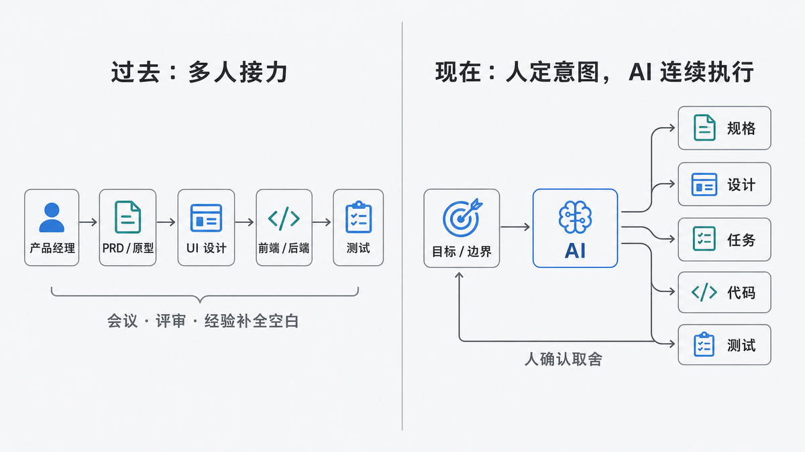
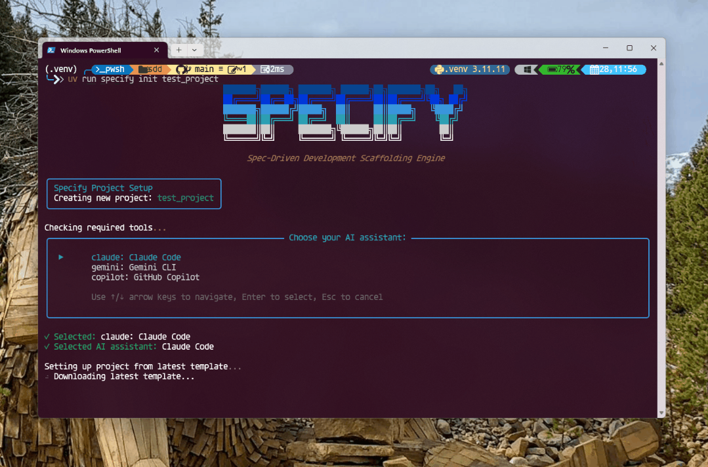
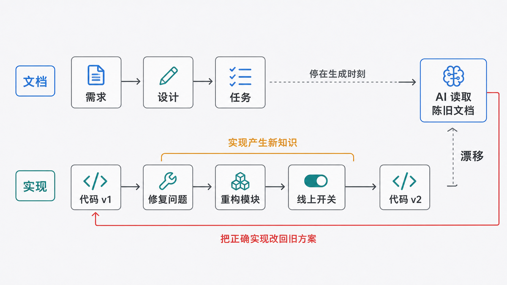
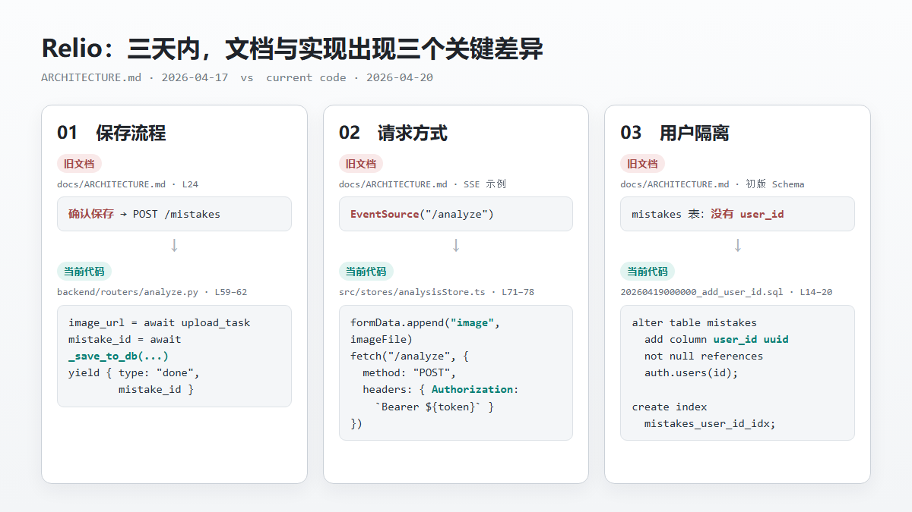
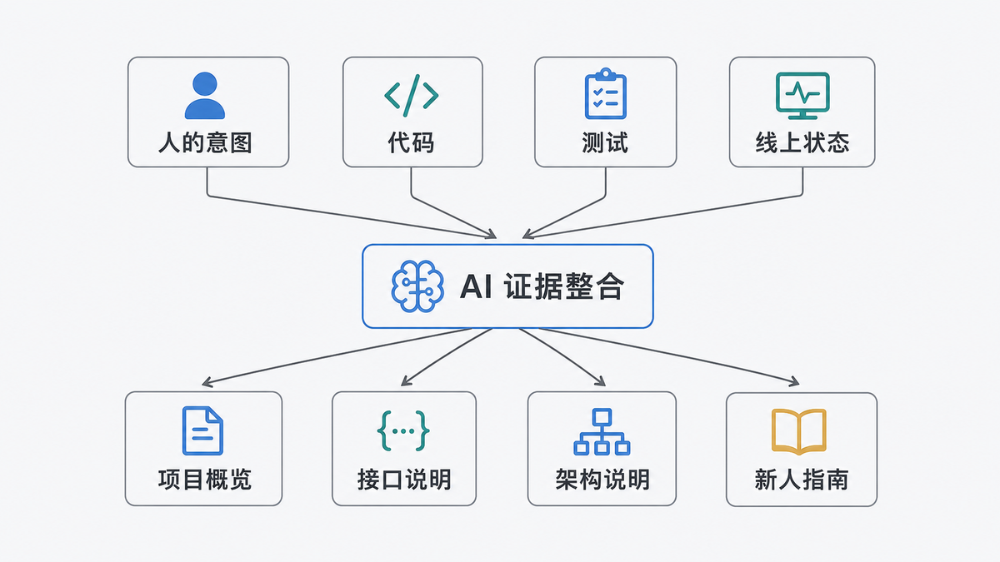
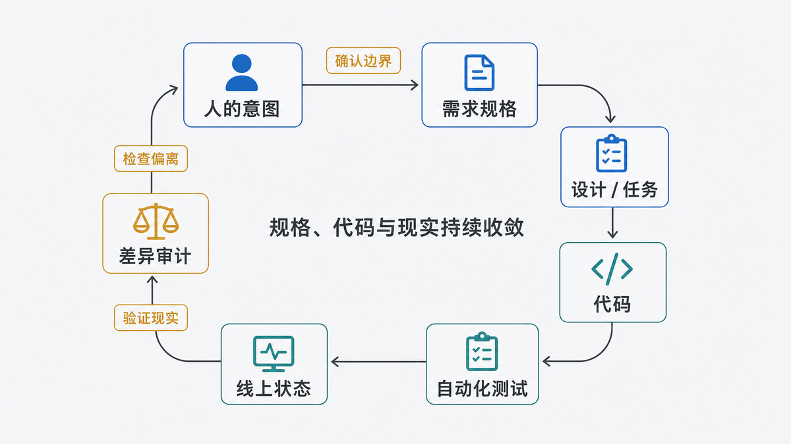

# 产品文档为什么总是过期？AI 正在换一种写法

> 状态：v6 结构性重写稿。
>
> 标题候选：
> A（当前主推）产品文档为什么总是过期？AI 正在换一种写法
> B AI 时代，PRD 不该再这样写了
> C 从 PRD 到代码：软件开发正在失去中间人

过去几十年，一款软件通常是被一群人接力做出来的。产品经理先从用户反馈、商业目标和老板的一句话里整理需求，写成 PRD，再画出原型。PRD 说明为什么做、给谁做、做到哪里为止；原型把页面顺序和操作流程画出来。

UI 设计师接过原型，补齐视觉层级、交互状态和异常反馈。前端工程师把设计稿变成用户能操作的页面，后端工程师把业务规则变成接口、数据库和任务。测试工程师最后沿着需求和设计逐项检查。

这个流程看上去像一条生产线，真正让它运转的却不是文档，而是文档之间无数次人的解释。比如一句“登录失败时给出友好提示”，产品经理不必在 PRD 里写清错误码、重试次数和按钮位置。设计师会追问，前端会根据组件习惯处理，后端会说明哪些错误可以区分。文档没有写完的部分，由会议、评审、经验和常识补上。

**过去产品文档最重要的作用，不是完整描述系统，而是让一群人对同一件事形成足够相似的理解。**

所以 PRD 天生是给人看的。它负责对齐目标、划定开发边界、暴露分歧，也给后来的争议留下一份共同依据。

AI 编程把这个前提改掉了。

今天，同一个人可以把一份需求交给 AI，让它继续生成技术方案、任务列表、数据库、接口、页面和测试。原来跨越四五个角色、持续数周的交接，可以压缩成一个下午里的几轮对话。

但 AI 不会自动拥有会议里的默契，也不会在看到一句模糊需求时主动走到工位旁边问清楚。它会把文档当成上下文，甚至当成执行命令。

**AI 时代，产品文档第一次从“给下一位同事看的交接材料”，变成了“可以直接产生代码的输入”。**

这让文档更重要，也让旧的写法更危险。



## 01 过去的文档，是给下一位同事看的

传统开发流程里，每种文档都服务于一个具体交接。PRD 从产品经理交给设计和研发，回答用户问题、业务目标、功能范围和验收口径；原型从产品交给 UI，回答有哪些页面、用户先做什么后做什么。

设计稿从 UI 交给前端，回答页面到底长什么样，以及加载、空白、报错、成功时分别显示什么。接口文档从后端交给前端，回答请求需要什么、返回什么、失败时怎么办。测试用例再把所有人的理解变成一组可以逐项检查的行为。

每一次交接都允许下一位专业人员继续判断。产品经理不需要决定数据库怎么拆表，UI 不需要写出接口超时策略，后端也不会仅凭一个按钮颜色推断收费规则。

这种分工有两个隐藏前提。第一，读文档的是人。人会结合经验理解省略，会发现矛盾，会提出问题，也会拒绝明显不合理的要求。

第二，文档不是唯一依据。团队每天沟通，评审原型，演示软件，再根据反馈修改。2001 年的[敏捷开发原则](https://agilemanifesto.org/principles.html)就强调业务人员和开发者要每天协作，能运行的软件才是衡量进展的主要标准。

换句话说，过去的产品文档更像一份协作协议，而不是一份可以直接编译的程序。

它不需要独自承担全部真相，因为团队本身就是补全信息的系统。

## 02 AI 把文档变成了可执行输入

AI 编程工具正在把传统接力流程折叠到一个上下文窗口里。

现在常见的做法是：先让 AI 把一句需求扩写成规格，再生成技术设计和任务列表，最后逐项实现。

[GitHub Spec Kit](https://github.com/github/spec-kit)把流程拆成 constitution、specify、plan、tasks、implement；[Kiro](https://kiro.dev/docs/specs/)则生成 `requirements.md`、`design.md` 和 `tasks.md`，再按任务执行。



这类方法通常被称为 Spec-Driven Development。本文沿用更容易理解的中文，把它叫作文档驱动开发，简称 SDD：先把意图写成结构化文档，再让 AI 依据文档生成代码。

SDD 解决了 AI 编程最明显的问题。

一句“做个会员系统”会让模型任意补全支付方式、套餐、退款和权限。规格先把用户故事、非目标、约束和验收条件写出来，AI 的发挥范围就小得多。

人也获得了几个暂停点：需求是否正确，技术方案是否合理，任务是否遗漏，确认之后才继续生成。

**SDD 的价值不是文档更多，而是把原本藏在脑子里的决定提前暴露出来。**

对于支付、权限、数据迁移、复杂业务规则，这一步非常有用。写代码之前发现“删除到底是彻底删除还是进入回收站”，远比发布后再修便宜。

Kiro 对好规格的定义也很具体：需求应该可测试、不预设技术方案、无歧义、彼此一致，并覆盖必要状态（[Kiro](https://kiro.dev/blog/deep-spec-analysis/)）。

但这里有一个容易被忽略的变化。

过去，一句模糊 PRD 会在几个人之间引发讨论。现在，它可能直接生成一批结构完整、命名专业、测试全绿的错误代码。

**同一份文档无法同时做好三件事：帮助人形成共识、约束 AI 执行、证明当前系统实际上怎样运行。**

## 03 SDD 解决模糊，也制造新的漂移

SDD 最危险的误解，是把“代码按照文档生成”当成“文档和代码从此一致”。

它们只在生成的那个瞬间可能一致。

实现开始以后，工程师和 AI 会不断发现文档没有预见的现实：现有接口不能这样改，数据库里已经有旧数据，第三方服务存在限流，移动端没有足够空间，某个需求会破坏已有用户习惯。

于是实现发生变化。一个错误被修掉，一次重构改变模块边界，一个线上开关暂时关闭功能。代码往前走了，最初的 `requirements.md`、`design.md` 和 `tasks.md` 却可能停在原地。

下一次 AI 再读取这些文档，它甚至会把正确实现识别成“偏离规格”，然后认真地改回旧方案。



**如果 SDD 只保证代码服从文档，它会把文档里的错误执行得更彻底。**

SDD 至少有四个局限。

- **规格可以清晰，但仍然选错问题。**AI 能发现一句话含糊，不能证明用户真的需要这个功能。Kiro 也明确承认，判断规格是否表达真实意图，最终仍然没有人之外的“标准答案”（[Kiro](https://kiro.dev/blog/deep-spec-analysis/)）。
- **实现会产生新知识。**技术限制、旧数据、性能和用户反馈，往往只有写到一半或上线后才出现。它们如果只进入代码，没有回到文档，漂移就开始了。
- **文档越多，冲突面越大。**PRD、需求规格、技术设计、任务、测试和代码可能分别保存一个版本的系统。生成五份文档很便宜，确认哪份仍然可信并不便宜。
- **任务完成不等于产品完成。**Spec Kit 项目的一条 issue 指出，原流程在 `implement` 后结束，合并、测试、文档更新和发布验证仍需人工补齐（[GitHub](https://github.com/github/spec-kit/issues/675)）。

还有一个更实际的问题：并非每次修改都值得启动完整 SDD。

改一个错别字、修一条已经定位的判断条件，如果先生成需求、设计和十个任务，文档生产本身可能比修改更大。Kiro 的最佳实践也建议把完整规格留给关键路径、复杂问题和需要审计的工作，明确的小修复可以直接处理（[Kiro](https://kiro.dev/docs/specs/best-practices/)）。

**好的流程不是文档越多越专业，而是每一项工作只生成它真正需要的约束。**

## 04 三天，足够让文档和代码分家

我拿自己的小学错题产品 [Relio](https://github.com/mrliuzhiyu/Relio) 做了一次实验。

学生拍下题目，系统分析答案和错因；同一个知识点反复出错后，再生成深度报告和针对练习。

仓库里没有 README，但有 PRD、架构说明和项目计划。我先隐藏 `docs/`，只让 AI 读取源代码、数据库迁移和配置，生成一份当前项目说明；然后再把人工文档拿出来逐项对照。

人工架构文档更新于 4 月 17 日，实验代码最后提交于 4 月 20 日。中间只有三天，三个会直接影响开发的事实已经不同。



这不是排版问题，而是工作方式产生的漂移。

产品经理照着旧文档，会把已经取消的确认页面重新画进流程。AI 编程代理照着旧文档，可能又写一套保存逻辑。新同事复制旧请求，第一张图片都发不出去。负责安全的人只看旧数据库设计，还会误判用户数据没有隔开。

完整过程和代码证据记录在 [Relio 实验对照](experiments/relio-comparison.md)中。

只读代码生成的说明，在保存流程、请求方式和数据库结构上比三天前的人工文档更准。

但它回答不了另一类问题：为什么产品不是帮孩子搜答案，而是解释为什么反复做错？为什么同一知识点错五次才生成报告？为什么家长只能看聚合报告，不能逐题监控孩子？

这些是产品边界和历史取舍。代码能留下结果，却恢复不了当时的理由。

**文档与代码漂移，不是简单地选一边相信，而是先判断这个问题本来应该由谁证明。**

## 05 不要寻找唯一真源，建立四层证据

很多团队试图选出一个“唯一真源”：以前选 PRD，后来选代码，现在又有人想选 AI 生成的规格。

这其实把不同问题混在了一起。

问“为什么做、不能做什么”，真源是人的意图和已经确认的决策。

问“系统具备什么实现”，真源是当前代码和配置。

问“哪些行为被持续保证”，真源是自动化测试、接口契约和数据库约束。

问“此刻线上真正开放了什么”，真源是部署状态、功能开关和监控。



代码里存在支付模块，不代表生产环境已经允许用户付款。测试通过，也不能证明远程开关没有关闭。PRD 写了一个功能，更不能证明它已经上线。

所以更准确的结构不是“文档驱动一切”，而是四层证据共同约束文档和代码。

**不要寻找一个万能真源。让每个结论从真正能证明它的那一层生成。**

人的意图层由人维护，保存目标、边界、非目标和取舍理由。

契约层尽量变成可执行证据，包括验收条件、接口定义、数据约束和测试。

实现层由代码和配置说明系统具备什么能力。

运行层由发布记录、远程开关和监控说明系统此刻真正怎样工作。

README、架构概览、接口说明和新人指南只是面向不同读者生成的视图。它们可以保存和审核，但不应该冒充新的原始依据。

## 06 把单向的 SDD 改成闭环

SDD 不需要被放弃，需要补上回程。

单向流程是：

闭环流程还要继续：



需求逻辑改变时，先修改意图和验收条件，再让代码跟上。

实现中只发生重构、修复或可行性调整时，则从代码和测试反向更新技术说明，不要假装最初的设计从未改变。

Thoughtworks 发布的 Structured-Prompt-Driven Development 把这一点写得很清楚：逻辑修正先回到结构化提示再进入代码；重构产生的结构变化则从代码同步回提示，让两边共同演进（[Martin Fowler](https://martinfowler.com/articles/structured-prompt-driven/)）。

Kiro 也要求需求变化后重新生成设计和任务，设计变化后反向验证需求，并同步相关文件（[Kiro](https://kiro.dev/docs/specs/best-practices/)）。

**实现完成不是 SDD 的终点。只有规格、代码、测试和运行结果重新收敛，一轮开发才真正结束。**

这个闭环有三个质量门。

- 开始前检查意图：解决谁的什么问题，成功是什么，明确不做什么。
- 合并前检查差异：哪些实现偏离了原规格，偏离是错误还是新知识。
- 发布后检查现实：线上配置、数据和用户行为是否支持文档里的结论。

GitHub Spec Kit 现在也提供 `/speckit.analyze` 检查不同规格产物之间的一致性，以及 `/speckit.converge` 对照代码、计划和任务补出剩余工作（[GitHub](https://github.com/github/spec-kit)）。

工具只是把检查做便宜。决定“应该改代码还是改文档”的人，仍然必须理解产品目标。

## 07 一套可以直接照做的开发流程

不需要先建立一座文档宫殿。一次功能开发，只要保留四类东西。

```text
README.md                 项目的门面

docs/
├─ WHY.md                 为什么做、为谁做、不做什么
├─ DECISIONS.md           重要选择、放弃方案、重新考虑条件
├─ RUNBOOK.md             部署、故障处理、外部系统操作
└─ generated/
   ├─ overview.md         当前项目概览
   ├─ architecture.md     当前模块和数据流
   └─ api.md              当前接口说明

AGENTS.md                 AI 修改项目必须遵守的规则
```

文件名不重要，所有权才重要。

`WHY.md` 和 `DECISIONS.md` 由人负责，因为代码无法恢复产品目标和被放弃方案。

接口、数据库、模块关系和启动方式尽量从代码、契约和配置生成，因为这些事实变化快，人工抄一遍最容易漂移。

开始一个中大型功能时，先给 AI 一份短 Feature Brief，而不是让它直接写完整 PRD。

```text
请先不要写代码。

目标用户：
要解决的问题：
期望出现的可观察结果：
明确不做的内容：
不能破坏的现有行为：
业务与合规约束：

先读取当前代码、测试、接口定义和数据库迁移，
列出需求与现状的差异、仍然含糊的决定和主要风险。
不要用猜测补齐产品决定。
```

这里最重要的是“先读取当前代码”。规格不能在一个想象中的空白项目上生成，它必须面对仓库已经存在的现实。

确认差异后，再让 AI 输出技术方案和任务。每一项验收条件必须能落到可观察行为，而不是“体验良好”“性能足够快”这类无法检查的词。

实现结束后，不要直接让 AI 重写所有文档。先生成差异报告。

```text
对照本次确认的需求、实现代码、测试和最终配置。

逐条列出：
1. 已按原规格实现的内容；
2. 实现偏离规格的内容；
3. 代码新增但规格没有记录的行为；
4. 规格写了但代码和测试无法证明的内容；
5. 必须由产品负责人确认的决定。

先输出差异，不要直接修改文档。
```

人确认差异之后，再分别处理。

产品目标改变，修改 `WHY.md`、需求和验收条件。

技术实现改变，更新测试、接口契约和生成型说明。

线上状态不同，更新发布配置和运行记录，不能用代码存在代替“已经上线”。

**先确认差异，再同步文档；先确认意图，再修改代码。**

## 08 人写得更少，但负责更重要的内容

AI 不会让 PRD 消失。

PRD 仍然需要回答谁遇到了什么问题、为什么现在解决、成功如何判断、哪些内容不在本次范围。它仍然是产品、设计、研发和业务形成共同理解的地方。

但 PRD 不应该继续承担数据库字段、当前接口参数、模块目录和每个页面实现状态。这些事实变化太快，也已经有更直接的证据。

AI 会让两类文档分得更开。

一类是人写的意图：目标、边界、非目标、取舍和责任。这些文字数量不多，却决定产品不会被做成另一件东西。

另一类是系统生成的现状：接口、数据结构、调用关系、启动方式和变更影响。它们应该随代码、测试和配置重新计算。

过去，产品文档的任务主要是让人对齐。现在，它还要约束 AI。

约束 AI 并不意味着把所有细节写成一座越来越大的文档仓库，而是让机器能区分：什么是人的决定，什么是当前实现，什么已经被测试，什么只在线上成立。

**未来最可靠的开发方式，不是让代码永远服从一份文档，而是让意图、规格、代码、测试和运行状态持续闭环。**

产品文档没有变得不重要。

它只是终于不必再假装自己是整个系统。
