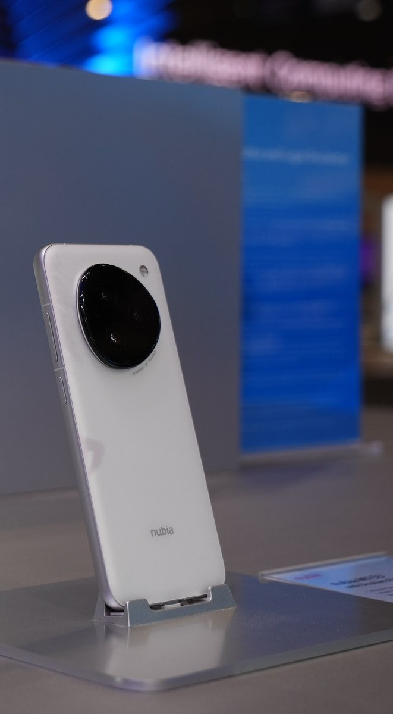
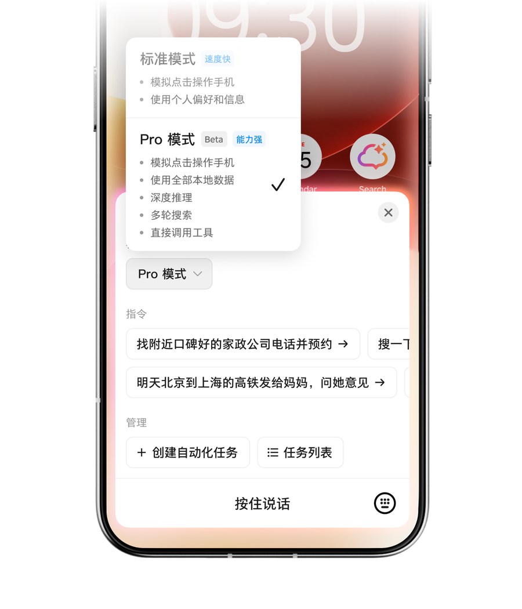

# AI 时代的软件，到底是给人用，还是给 AI 用？

过去二十年，我们使用软件的顺序几乎没有变过。

想订酒店，先打开旅行应用；想做演示文稿，先打开办公软件；想报销，再去公司系统里找对应入口。人先选择软件，再学习菜单、按钮和流程。

AI 正在把这个顺序倒过来。

越来越多人不再先想该打开哪个应用，而是先打开豆包、千问或 DeepSeek，直接说出自己要做什么。

查资料、修图片、写方案、做演示文稿，原来分散在几个软件里的事情，开始从同一个入口出发。

当 AI 只负责回答问题时，这还只是搜索框换了一种样子。但当它开始订酒店、填表格、提交申请，问题就变了：它必须进入其他软件，读取真实数据，并调用那些原本藏在按钮后面的能力。

这会逼所有产品回答一个很现实的问题。

如果用户以后越来越少直接打开你的软件，你还应该继续把全部能力做成页面吗？如果任务会由 AI 发起，你又该把什么交给 AI，什么必须留给人？

这个问题已经不是未来预测。

QuestMobile 统计显示，2026 年 6 月，豆包、千问和 DeepSeek 的月活用户分别约为 3.82 亿、1.67 亿和 1.29 亿。

用户已经在用脚投票，只是变化并没有按照硅谷发布会里的方式发生。

真正先跑出来的，不是聊天框里的自动付款，而是一个新的任务入口。理解这个入口，才能看清接下来软件会变成什么样。

## 01 用户先选择了一个新的超级入口

豆包现在的产品形态很有代表性。

它的应用介绍里同时列着问答、搜索、修图、写作、翻译、演示文稿和语音通话，还增加了办公任务模式与购物助手。

用户不必先判断应该打开文档、图片还是视频应用，只要说出目标，豆包再决定调用哪种能力。

这里真正改变的不是功能数量，而是使用软件的起点。

过去是先选应用，再找功能；现在是先进入 AI，再表达目标。

QuestMobile 把豆包的方向概括为模型智能体化的执行落地，因为它正在从回答问题走向交付文档、表格、图片、视频和办公任务。

当然，豆包还不能可靠操作所有软件。很多任务仍然发生在它自己的界面里，跨平台执行也会遇到登录、权限、数据格式和风控限制。

但产品习惯一旦形成，影响就会向外扩散。用户会逐渐期待所有软件都能听懂目标，而不是要求自己先学会每个系统的导航。

DeepSeek 提供了另一种对照。

它同样拥有巨大的用户规模，但用户更常在遇到难题时找它推理和回答。两者都属于 AI 助手，产品心智却已经分叉：DeepSeek 更接近认知入口，豆包开始争夺任务入口。

前者改变人们获得答案的方式，后者可能改变其他应用被发现和使用的方式。

## 02 为什么现在突然出现这么多 AI 手机

如果 AI 只负责写一段文字、修一张图片，做成普通 App 就够了。

但要替用户完成一件事，App 很快会碰到边界。它看不全其他应用里的状态，也不能稳定调用联系人、定位、相机、通知和支付，更不能随意跨过各个应用的权限沙箱。

这正是 AI 开始进入手机系统的原因。

手机是一个人最常随身携带的设备，也是数字生活里上下文最完整的地方。它知道时间和位置，连接相机、麦克风与通讯录，还装着支付、出行、购物和办公应用。

只有进入系统层，AI 才可能在用户授权后，把这些信息和能力串成一条任务。

努比亚 M153，也就是外界常说的豆包手机，是这个方向的早期样本。

图 1 · 努比亚 M153 豆包手机助手技术预览产品 · 图源：中兴通讯

它并不是字节跳动从头制造的一部手机。硬件由努比亚负责，豆包手机助手则与努比亚进行操作系统层面的合作。中兴官方称，它可以理解自然语言指令，并跨应用完成搜索、比较、预订和导航等连续步骤。

图 2 · Pro 模式可使用本地数据、搜索并调用工具 · 图源：豆包手机助手官网

但这仍然是一台面向开发者和科技爱好者限量发售的技术预览产品。它证明了系统级智能体可以怎样工作，没有证明普通用户已经愿意把整部手机交给 AI。

现在市场上的 AI 手机也不是同一种东西。

第一类是在原有手机上增加修图、摘要、翻译和搜索，AI 只是更方便的功能。第二类才是在重做操作系统的任务调度，让 AI 可以读取上下文、跨应用行动，并在端侧和云端之间分配计算。

手机厂商集体进入这一层，还有一个商业原因。

硬件参数越来越接近，单靠屏幕、相机和芯片很难长期拉开差距。谁掌握系统里的默认 AI，谁就可能决定用户先看到什么服务、调用哪个应用、在哪个平台完成交易。

对豆包来说，进入手机可以减少对其他系统入口的依赖。对手机厂商来说，如果把这一层完全交给外部模型，自己的操作系统很可能退化成硬件外壳。

所以这场竞争表面上在卖 AI 手机，实际争夺的是下一代软件入口。

不过，系统权限越大，风险也越集中。跨应用权限、长期记忆、隐私合规和失败后的责任，仍是当前 AI 手机最难解决的部分。

这也再次说明，AI 不能只获得能力。它还必须被限制在清楚、可撤销、可追踪的边界里。

## 03 千问把入口继续推进到了交易

千问走得更直接。

它当前的应用介绍不只写问答和办公，还列出了点外卖、订酒店、找餐厅和办理部分政务服务。

模型并没有突然学会送外卖。真正发生的是，阿里原有的电商、旅行、本地生活、支付和小程序服务，被重新组织成了 AI 可以调用的能力。

比如用户提出一个具体需求：今晚十点到杭州，希望找一家有停车场、能够延迟入住的酒店。

AI 负责理解时间、地点和偏好。旅行服务负责查询库存与价格，支付系统负责扣款，酒店系统负责生成订单和履约。

用户看到的是一句话完成一件事，背后仍是多个成熟系统在完成各自确定的工作。AI 没有取代这些软件，只是站到了它们前面。

这也解释了豆包和千问的差异。

豆包拥有巨大的用户入口，以及内容和多媒体能力。千问背靠阿里生态，已经连接大量交易和生活服务。

两家公司都在做 AI 应用，但它们最终能办成什么事，很大程度上取决于背后有哪些真实服务可以调用。

模型决定它能不能听懂，软件生态决定它能不能办完。

所以，AI 产品的竞争正在分成两层。前台争夺的是谁更容易让用户表达目标，后台争夺的是谁拥有更多可以被稳定执行的服务。

## 04 即时结账没有普及，但仍是一个好样本

这时再看 OpenAI 的即时结账，它的位置就清楚多了。

2025 年发布时，这项功能只从美国 Etsy 卖家和单件商品开始。OpenAI 没有公开它单独的使用规模，因此不能用它证明人们已经习惯在聊天框里购物。

它的价值不在用户规模，而在于把系统边界展示得很清楚。

用户可以在 ChatGPT 里发现商品、确认订单和付款信息。但库存、支付、履约、退货和客服，仍由商家原来的系统处理。

ChatGPT 没有成为订单数据库，也没有接管商家。它只是获得了发起交易的入口。

第三方应用又补上了界面。

Booking.com 可以在对话里返回酒店卡片，Zillow 可以返回房源地图，Canva 可以返回可以继续编辑的演示文稿。

用户先用语言提出目标，到了比较、选择和修改的时候，图形界面再出现。

这个方向同样处在早期。但它至少说明了一件事：AI 成为入口，不代表所有产品最后只剩一个聊天框。

把豆包、千问和 ChatGPT 放在一起看，它们代表三种不同的组合。

豆包先占据通用入口，再扩大任务能力；千问利用现成生态，把入口连接到交易；ChatGPT 则尝试让外部开发者把能力和界面一起送进 AI 宿主。

## 05 不是每个产品都应该去做下一个豆包

通用 AI 入口是一场极其昂贵的竞争。

它需要模型、分发、语音、多模态、长期记忆和终端入口，还需要足够多的内容与服务生态。大多数软件公司没有必要在首页复制一个聊天框，然后假装自己也在做超级助手。

更现实的选择，是先判断自己的产品处在哪一层。

如果做的是通用助手，用户每天直接打开你，产品重点确实是对话、语音、记忆、任务编排和生态连接。豆包、千问和 ChatGPT 争夺的是这一层。

如果做的是酒店、外卖、票务、支付、企业审批这类服务，价值不在聊天入口，而在库存、规则、价格、订单和履约。

这类产品应该让 AI 能理解并调用自己的核心能力，同时保留账户、状态、风控、售后和品牌关系。即使入口发生变化，业务事实仍然由自己的系统保存。

如果做的是设计、财务、开发和数据分析这类专业工具，原来的界面更不会消失。

画布、表格、时间线和代码编辑器都比聊天更适合精细工作。AI 可以读取上下文、执行重复步骤、生成初稿，但人仍然需要一个稳定的工作台完成检查、修改和追责。

这三层并不冲突。

一个专业工具可以同时拥有自己的工作台、供内部 AI 使用的动作层，以及供外部助手调用的服务入口。

真正需要避免的是把三层混在一起。既没有豆包的入口规模，也没有专业工具的操作深度，只多了一个什么都能问、什么都做不稳的聊天框。

## 06 普通产品怎么开始：先改造一条任务

拿一款采购软件举例。

用户现在要打开资产目录、预算系统、供应商列表和审批页面，才能给新设计师申请一台电脑。

如果团队先做一个万能助手，模型就要猜每个页面的字段和顺序。页面一改、弹窗一多，任务很快就会卡住。

第一步不是选模型，而是跟着一张已经完成的采购单走到底。

团队需要写清楚这张采购单查过哪些数据，在哪一步比较方案，谁能批准，什么动作会产生真实影响。

最后得到的不是一张页面清单，而是一条任务链：查政策、查预算、找商品、创建草稿、预览影响、提交审批、查询状态。

第二步，只开放查询和草稿能力。

AI 可以读取政策、核对预算、搜索商品并填写申请，但不能真正提交。团队先观察用户最常补充什么信息，AI 最容易误解哪个字段，人工接管发生在哪里。

这个阶段即使失败，也只是一张草稿不完整，不会真的多买一台电脑。

第三步，只在两个时刻做界面。

比较电脑时，返回价格、配置、交付时间和预算影响；提交审批时，显示最终金额、成本中心、收货人和审批链。

其他信息收集和页面跳转交给 AI。界面只负责文字不擅长的比较，以及人必须承担责任的确认。

最后再开放有限执行。

AI 使用独立身份，只获得本次任务需要的权限。每次写入都带防重复标识，提交后返回可以查询的状态。

低于限额、规则明确的申请可以自动送审。超预算、修改收货人或删除记录时，再请人处理。

上线后也不要只看回答是否自然。更应该记录任务一次完成率、人工接管位置、重复操作、失败恢复率和总耗时。

如果未来要接入不同 AI 客户端，再用 MCP 等协议把这些动作暴露出去。

协议解决怎么连接，前面的任务拆解解决连接什么。顺序反过来，通常只会得到一批可以被调用，却很难被正确使用的接口。

## 结尾

回到最开始的问题：软件到底应该给人用，还是给 AI 用？

答案不是二选一，而是分层。

豆包这类入口产品首先给人用，因为人要在这里表达目标。

酒店、票务和企业服务会越来越多地给 AI 调用，因为任务会从入口流进来。

专业软件仍然要给人保留稳定界面，因为精细判断和责任不会消失。

即时结账没有证明页面即将消失。它与豆包、千问共同证明的是，软件的入口、界面和能力正在分开。

对大多数产品，真正可行的形态只有三件事：AI 能调用核心能力，人能在关键时刻看见并接管，业务系统始终保存真实状态。

所以，最先值得重做的不是首页。

是用户真正想完成的那条任务。

## 参考资料

- [QuestMobile 2026 年 AI 应用市场发展半年报](https://www.questmobile.com.cn/research/report/2076954943839809537/)
- [豆包 · 中国区 App Store 产品介绍](https://apps.apple.com/cn/app/%E8%B1%86%E5%8C%85-%E9%9A%8F%E6%97%B6%E5%B8%AE%E5%BF%99%E7%9A%84-ai-%E5%8A%A9%E6%89%8B/id6459478672)
- [千问 · 中国区 App Store 产品介绍](https://apps.apple.com/cn/app/%E5%8D%83%E9%97%AE-%E9%98%BF%E9%87%8Cai%E5%8A%A9%E6%89%8B/id6466733523)
- [豆包手机助手 · 官方网站](https://o.doubao.com/)
- [努比亚 M153 与豆包手机助手 · 中兴通讯](https://www.zte.com.cn/global/about/news/As-an-AI-Native-Phone-Pioneer-nubia-Reshapes-the-Paradigm-of-Human-Device-Interaction-at-MWC-Barcelona-2026.html)
- [WAIC 智能终端产业质变已至 · IDC](https://www.idc.com/resource-center/blog/waic-%E6%99%BA%E8%83%BD%E7%BB%88%E7%AB%AF%E4%BA%A7%E4%B8%9A%E8%B4%A8%E5%8F%98%E5%B7%B2%E8%87%B3%EF%BC%9A%E7%8E%B0%E5%9C%BA%E5%AE%9E%E6%99%AF%E5%92%8Cidc%E6%95%B0%E6%8D%AE%E5%91%8A%E8%AF%89%E6%88%91/)
- [Buy it in ChatGPT: Instant Checkout and the Agentic Commerce Protocol · OpenAI](https://openai.com/index/buy-it-in-chatgpt/)
- [Introducing apps in ChatGPT and the new Apps SDK · OpenAI](https://openai.com/index/introducing-apps-in-chatgpt/)
- [Tools · Model Context Protocol](https://modelcontextprotocol.io/specification/2025-11-25/server/tools)
