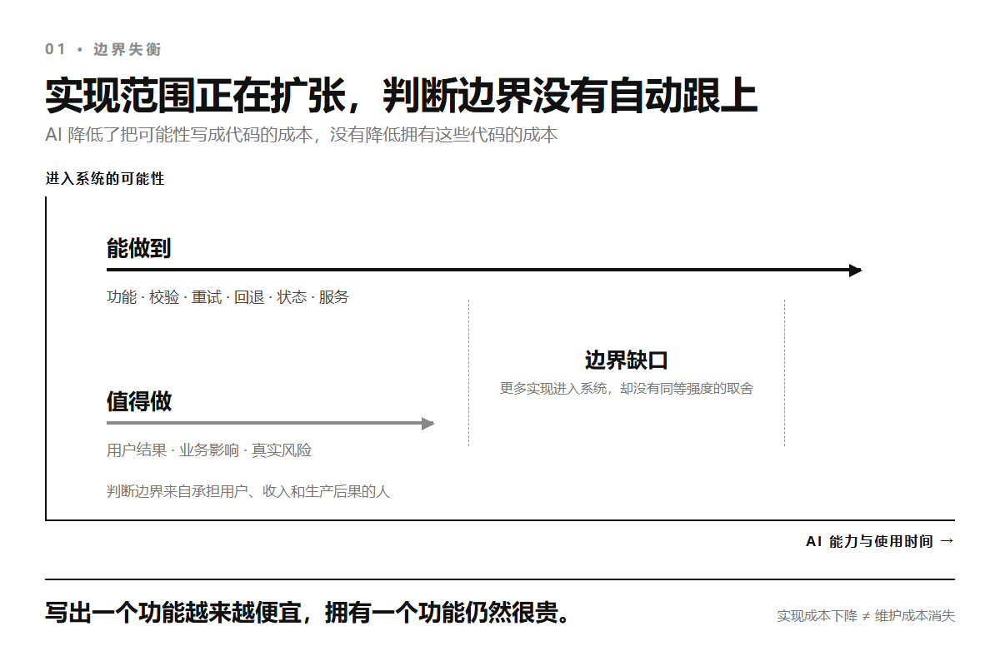
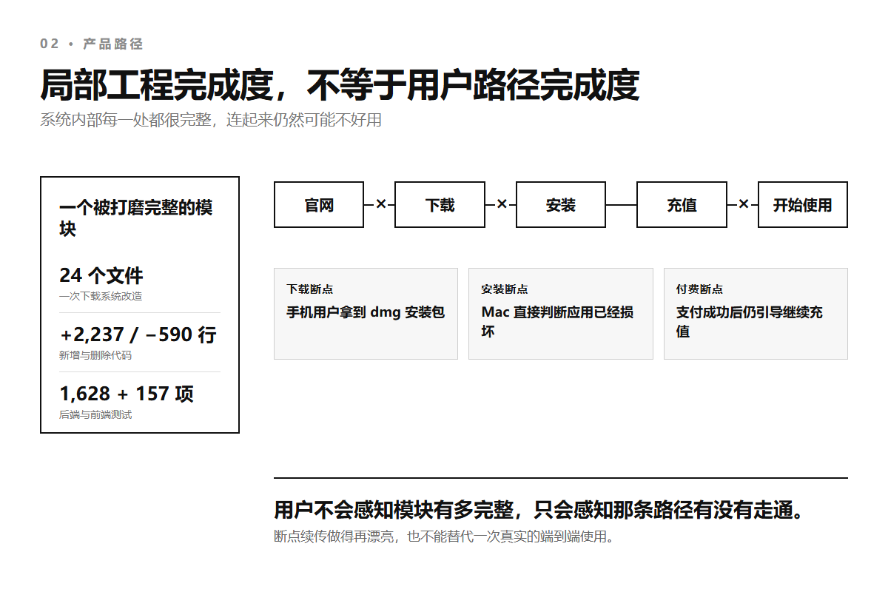
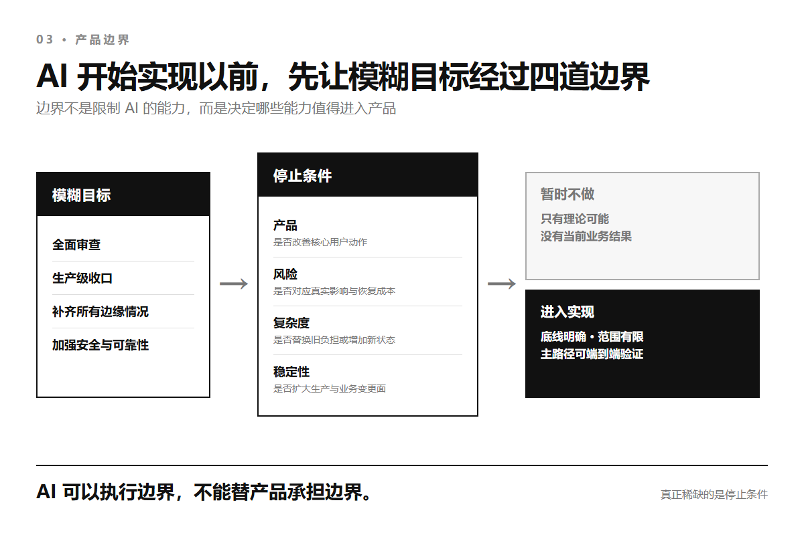

# AI 能帮你扩展边界，但不能替你守住边界

把一个真实产品交给 AI 以后，最容易说的一句话是：全面检查一下。

再认真一点，还会补上生产级、覆盖所有边缘情况、把安全和稳定性收口。

AI 会很快找到事情做。

下载没有断点续传，它补上续传、校验、超时、取消和并发锁。

登录有被撞库的可能，它增加设备识别、频率限制、失败锁定和异常告警。

接口偶尔失败，它加入重试、回退、熔断、降级和更多状态。

每一项单独看都合理。

过几天再让它全面检查一次，它还能从新系统里继续找到新的缺口。

产品于是进入一种没有完成时刻的开发。

代码越来越多，测试越来越密，后台越来越完整，用户真正要走的那条路却没有同步变短。

更麻烦的是，系统每增加一层防御，就多一份配置、多一条失败路径、多一块以后必须理解和维护的状态。

最后得到的未必是一堆明显写错的代码。

更常见的是一个每一处都能解释、每一层都有理由、整体却没人再敢改的系统。

**AI 擅长把可能变成实现，却不会自动决定哪些可能性根本不该进入产品。**

它能帮你不断扩展边界。

守住边界，是另一种工作。

## 01 实现成本曾经替产品踩刹车

过去，一个功能要改二十个文件、增加三种回退、维护一套新状态，团队会自然停下来算一遍。

用户真的需要吗？

这个风险发生过吗？

现在做，是否比先解决付费、留存或主路径上的断点更重要？

开发成本很高，所以很多想法会在讨论阶段被拒绝。

这种限制当然拖慢了好功能，也在暗中挡住了大量不重要的代码。

AI 把这块天然刹车拆掉了。

它不会因为要改二十个文件就嫌麻烦，也不会因为第十个分支条件和当前收入无关就主动停手。

只要目标仍然是更完整、更稳健、更通用，它就能继续往外扩。

[DORA 2025 年的 AI 辅助软件开发报告](https://dora.dev/research/2025/dora-report/)把 AI 的主要作用概括为放大器。

它会放大一套组织原有的优势，也会放大原有的弱点。

目标清楚时，它把短路径做得更快；目标含糊时，它也会把含糊扩展成完整系统。

一篇讨论 AI 编程与架构的论文做过一个说明性案例。

同一个客服任务，提示词只增加结构化输出和工具调用，生成结果就从 2 个文件、141 行代码变成 6 个文件、827 行代码。

多出来的是校验、重试、回退、工具路由和状态存储。

作者把这种现象称为[没有架构师的架构](https://arxiv.org/abs/2604.04990)：自然语言里看起来很小的要求，会在实现里变成新的组件、依赖和失败模式。

这个案例每种提示只运行了一次，不能用来证明 AI 必然让代码增长某个比例。

它真正说明的是另一件事。

以前需要开会决定的一层架构，现在可能在一句提示之后就已经写完并通过测试。

代码出现得太快，再问它是否值得存在，反而成了更困难的动作。

## 02 局部越完整，产品可能越失控

我在自己的一个线上产品里遇到过这种反差。

它有网页、Windows 和 macOS 客户端、充值支付、模型路由、管理后台，还有完整的发布与更新流程。

不到一个月，AI 协作产生了 96 个提交，新增 20,614 行，删除 62,362 行，前后碰过 496 个文件。

删除量的大头来自一次旧客户端退役，所以这些数字不能证明代码膨胀。

它们能证明的是，AI 已经可以在很短时间里推动一个真实产品的大面积改写。

其中一次任务来自一个很具体的问题。

用户在客户端下载外部工具时切换页面，再回来，文件有时会卡住。

AI 很快找到根因。

下载状态只存在页面组件里，页面关掉后后台任务还在继续，用户再次点击会让两个任务同时写同一个文件。

旧实现也没有超时、不能取消、不能续传，两个下载入口还复制了相似代码。

这些判断都对。

AI 最后重做了一套统一下载系统，加入进程级任务中心、并发锁、取消、停滞超时、断点续传、文件校验和占用回退。

这次改动碰了 24 个文件，新增 2,237 行，删除 590 行。

后端 1,628 项测试和前端 157 项测试全部通过。

我不能把这些代码简单叫作垃圾。

它解决了真实问题，结构也比两套复制的下载逻辑更干净。

问题出现在我把视线从下载模块移回整个产品以后。

同一时期，iPhone 用户打开官网会被识别成 Mac，首屏按钮让他下载 dmg。

Mac 安装包的签名方式不对，系统直接判断应用已经损坏，而官网给出的放行教程根本不会生效。

账户余额已经为零，客户端仍然显示线路已连接。

用户刚付完钱，成功页最显眼的按钮不是开始使用，而是继续充值。

一个上百兆的安装包可以在断网后精确续传，用户却可能从一开始就拿到完全不能安装的文件。

工程上最复杂的路被认真铺平了，真正的用户入口仍然选错了。

这种产品不是没有边界条件。

恰恰相反，它的每个模块都堆了很多边界条件。

它缺的是整个产品的边界：哪条用户路径最重要，哪个失败此刻最贵，什么能力即使能做也暂时不做。

## 03 过度安全，也是没有边界

过度工程不只表现为微服务太多、抽象太早或框架太重。

它还有一种更难反对的形式：为了安全和可靠，再多做一点防御。

AI 尤其擅长列举可能性。

一次请求可能超时，重试时可能重复执行，回退可能再次失败，错误信息可能泄露细节，用户输入可能包含异常内容，管理员账号可能被盗。

这些都是真的。

但可能发生，不等于现在值得为它增加一套系统。

风险必须同时看发生概率、影响范围、恢复成本，以及它和当前业务的关系。

没有这些权重，AI 会把每一种理论风险都当成同等重要的工程任务。

结果可能是一个可逆操作也要三次确认，一次偶发失败套上五层重试，一段普通输入被十几条规则拒绝，用户被安全策略锁住以后却没有可靠的恢复入口。

安全控件更多，实际安全结果未必更好。

[NIST 的可用安全研究](https://csrc.nist.gov/news/2019/usable-cybersecurity-research-at-nist)明确提醒，过于严格的流程会让系统难以使用，用户甚至会主动绕开安全措施。

[CISA 的安全设计原则](https://www.cisa.gov/sites/default/files/2023-12/SbD-Alert-How-Software-Manufacturers-Can-Protect-Customers-by-Eliminating-Default-Passwords-508c_0.pdf)也不是要求把更多配置和判断交给用户，而是要求厂商承担责任，让最容易走的路同时成为安全的路。

可靠性同样不是越高越好。

[Google SRE 关于风险的章节](https://sre.google/sre-book/embracing-risk/)直接把 100% 可靠性称为普通服务通常不该追求的目标。

继续增加一个 9，会消耗基础设施，也会消耗本可以用于用户功能、技术债和运营成本的工程时间。

Google 用服务目标和错误预算平衡发布速度与可靠性，因为可靠到什么程度首先是产品问题，不是一个脱离业务的技术竞赛。

支付不能重复入账，权限不能越权，用户数据必须有备份，这些是真正的底线。

它们应该由幂等约束、最小权限、安全默认值和可验证的恢复流程守住。

另一边，给每个可逆动作增加确认、为没有出现过的规模预建容灾、用无限重试掩盖真实故障，只是在扩大攻击面和故障面。

**安全不是控件越多，可靠也不是分支越多。**

系统真正要守住的，是用户能够安全完成核心动作，业务在失败以后能够恢复。

## 04 测试全绿，也可能正在长成屎山

AI 生成的系统最容易给人一种确定感。

它写代码，也补测试；发现一个异常，再为异常增加一个分支和一组用例。

当前需求被证明满足以后，这次任务就显示完成。

但测试只证明已知输入得到已知结果，不会自动证明这套结构适合下一次变化。

2026 年的 [SlopCodeBench](https://arxiv.org/abs/2603.24755)专门观察编程智能体在需求逐轮变化时，如何继续扩展自己此前写下的代码。

论文更新版包含 36 个问题和 196 个检查点。

在它的度量下，77% 的轨迹出现结构侵蚀，75.5% 的轨迹冗余度上升；与 473 个开源 Python 仓库相比，智能体代码的冗余度是 2.3 倍，结构侵蚀度是 2 倍。

这是一份预印本，也是受控基准，不能把比例直接套到所有生产项目。

但它抓住了单次评测经常漏掉的问题。

代码可以一直通过当前测试，同时把更多分支塞进已经很复杂的函数，把相似逻辑复制到新路径，再用新的特殊情况补住昨天的设计。

系统没有在某一天突然变坏。

它只是每次都以最小代价通过眼前检查，直到下一次改动必须同时理解几十个局部正确的决定。

这就是很多 AI 项目最后变成屎山的过程。

不是因为模型每次都写错，而是因为没有任何外部机制要求它为整个系统保持简单。

只在提示词里加一句保持代码整洁也不够。

SlopCodeBench 的提示干预能改善初始代码，却没有阻止后续迭代中的退化。

另一项重构研究 [CodeTaste](https://arxiv.org/abs/2603.04177)也发现，模型拿到明确的重构要求时执行得不错，只给宽泛的改进范围时，却经常找不到人类维护者真正会选的方向。

AI 可以很好地完成删什么。

决定什么应该被删，仍然是另一种判断。

## 05 工程稳定，可能正在伤害业务稳定

产品里的稳定至少有三层。

代码层关心函数有没有异常、请求能不能重试、测试是否通过。

运行层关心发布会不会中断服务、数据能不能恢复、故障能不能定位。

业务层关心用户能不能注册、付费、开始使用，以及一条正在赚钱的主路径会不会被下一次优化改断。

AI 最容易看见第一层，因为代码和测试就在眼前。

它也能通过日志、监控和部署配置帮助第二层。

第三层需要知道一次失败损失的是几分钟计算、一个新用户，还是一笔已经支付的订单。

这些后果不在代码里自然出现。

当全面加固变成持续目标，稳定的业务路径会被频繁触碰。

一个重试机制可能改变请求时序，一个统一状态中心可能改变所有页面，一个更严格的权限模型可能让老用户失去入口，一个新服务会让每次部署多一个必须正常工作的依赖。

每个修改都在提高某个局部指标，整条业务链却要承受更多联动变化。

Martin Fowler 在 [YAGNI](https://martinfowler.com/bliki/Yagni.html)里把提前构建能力的代价拆成建设成本、延迟价值、持续携带和未来修复。

AI 大幅降低的是第一项。

用户等待更久、团队持续理解额外结构、未来为错误抽象返工，这些成本没有一起消失。

**写出一个功能越来越便宜，拥有一个功能仍然很贵。**

如果每次工程审查都让系统得到更多能力，却没有删掉旧路径、减少状态或改善核心业务结果，所谓稳定最终只存在于测试报告里。

## 06 AI 可以执行边界，不能替产品承担边界

我后来改变了给 AI 任务的方式。

目标不再是全面看看还能补什么，而是先固定一个用户此刻要完成的动作。

下载以后能打开，付费以后能开始用，线路坏了能看见真实原因，也知道下一步去哪里。

这条主路径之外的能力会明确写成暂时不做。

实现之前，AI 先列出方案会增加哪些状态、服务、数据表、依赖和失败路径。

新结构不能因为写得出来就默认进入系统。

它要么替换一段旧逻辑，要么解决一个已经发生的风险，要么直接改善当前最重要的用户结果。

安全问题也不再按可能性数量排队。

支付、身份、权限、数据和密钥有不可突破的底线，底线写进权限、约束和自动检查。

其他风险按真实使用、业务影响与恢复成本决定投入，不把防御步骤转嫁给用户。

验收顺序也变了。

我会先从官网点一次下载，用新账户完成付费，再打开工具发出第一条请求。

整条路走通以后，测试负责保证它不会再次断掉。

这样做并不是把 AI 赶出决策。

它很适合反过来挑战方案，找遗漏，估算复杂度，执行已经声明的规则，也能在越界时拒绝修改。

**AI 能守住一条已经写清的边界，却不能替承担后果的人发明这条边界。**

这个项目后来最明显的几次改善都很小。

手机用户不再拿到 Mac 安装包，零余额不再显示假连接，支付成功以后主按钮变成开始使用，外部工具不再承诺做不到的自动配置。

AI 仍然可以继续列出几十种加强方案。

产品第一次有了一个比方案更稳定的东西：一条不会被下一轮全面优化冲散的用户主路径。

---

## 参考资料

- [DORA｜State of AI-assisted Software Development 2025](https://dora.dev/research/2025/dora-report/)
- [Architecture Without Architects: How AI Coding Agents Shape Software Architecture](https://arxiv.org/abs/2604.04990)
- [Google SRE｜Embracing Risk](https://sre.google/sre-book/embracing-risk/)
- [NIST｜Usable Cybersecurity Research](https://csrc.nist.gov/news/2019/usable-cybersecurity-research-at-nist)
- [CISA｜How Software Manufacturers Can Protect Customers by Eliminating Default Passwords](https://www.cisa.gov/sites/default/files/2023-12/SbD-Alert-How-Software-Manufacturers-Can-Protect-Customers-by-Eliminating-Default-Passwords-508c_0.pdf)
- [SlopCodeBench: Benchmarking How Coding Agents Degrade Over Long-Horizon Iterative Tasks](https://arxiv.org/abs/2603.24755)
- [CodeTaste: Can LLMs Generate Human-Level Code Refactorings?](https://arxiv.org/abs/2603.04177)
- [Martin Fowler｜Yagni](https://martinfowler.com/bliki/Yagni.html)
