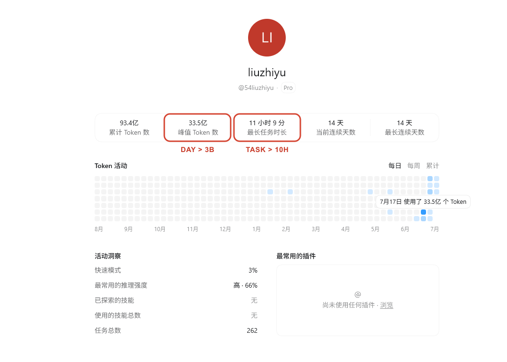
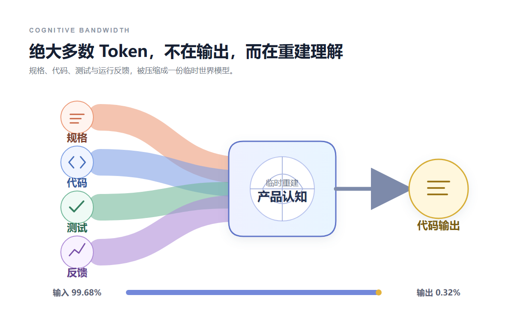
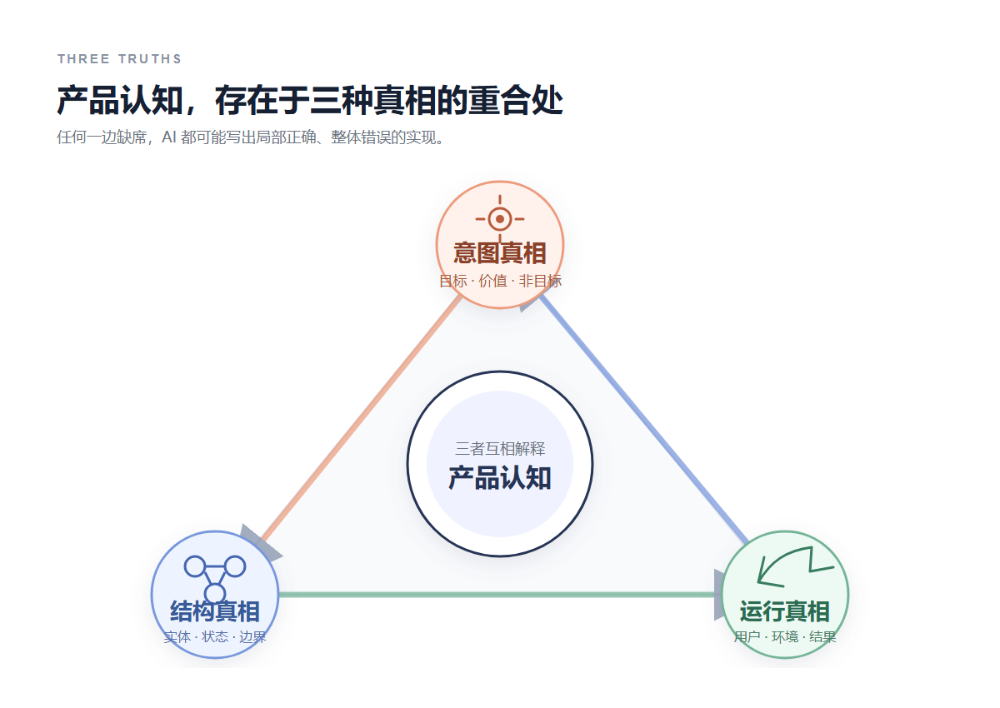
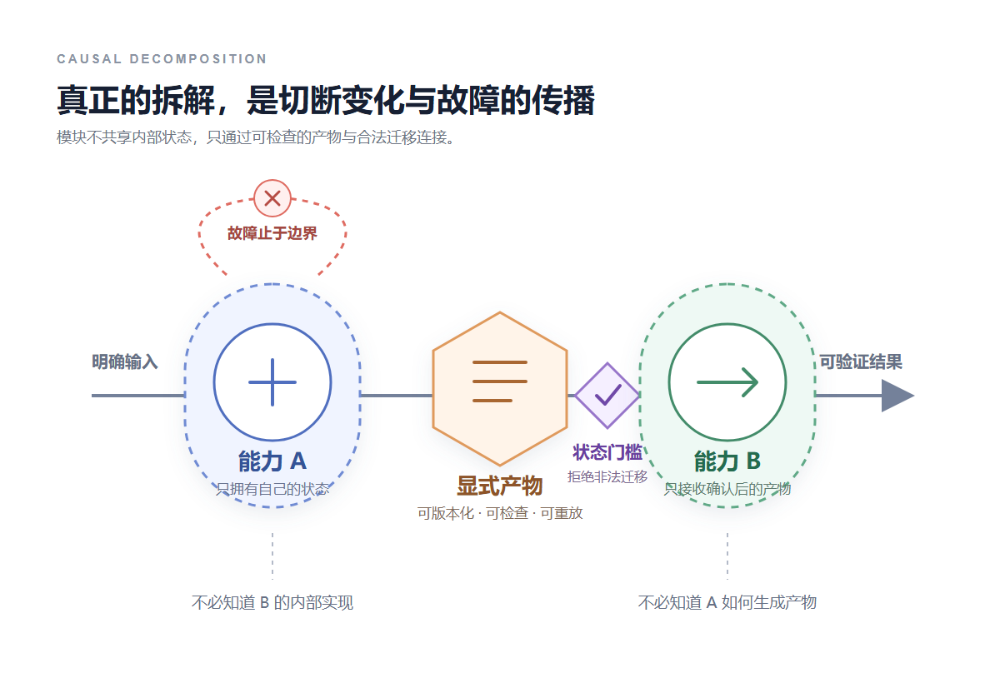
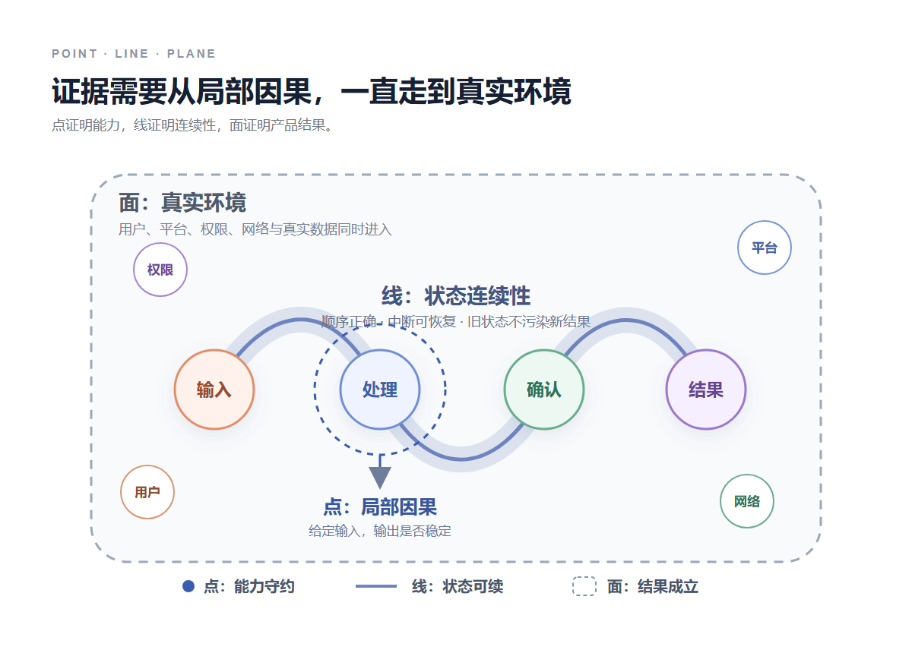

# 一天消耗超过 30 亿 Token，我是怎么让 AI 理解产品的？

有一天，我的 AI 单日峰值用量达到 33.5 亿 Token。

同一张面板上，最长一次任务持续了 11 小时 9 分。也就是说，单日消耗超过 30 亿 Token，单次任务超过 10 小时。

如果把 Token 理解成模型写了多少东西，这个数字很难解释。模型最终留下的代码和文档远没有那么多。

我拆过当天一条可以复核的会话。它累计消耗 1.23 亿 Token，其中 99.68% 是输入，输出只占 0.32%。输入里面，又有 97.5% 是缓存命中。

模型大部分时间不在写，而是在读。它反复读取规格、代码、测试和运行反馈，再根据这些材料临时建立一套对产品的理解。

这让我开始用另一种方式理解 Token。

**Token 不是代码产量，更接近模型重建认知时占用的带宽。**

AI 能不能把产品做对，取决于它重建出来的认知是否完整。代码生成只是这套认知在某个局部上的一次输出。

## 01 上下文窗口不是记忆，而是一次临时重建

人长期参与一个产品，会逐渐形成很多没有写下来的理解。为什么当初这样设计，哪个状态最危险，哪条路径是主路径，某个看似多余的判断实际上在保护什么。

AI 没有这种连续经验。

每次新任务开始，它只能根据当前上下文重新推断产品是什么。规格文档告诉它意图，代码告诉它已经存在的结构，测试告诉它哪些行为被固定下来，运行反馈告诉它真实世界发生了什么。

这些材料不是记忆本身，只是重建记忆的原料。

缓存命中可以让重复读取变便宜，但不会让上一次会话的理解自动成为下一次会话的理解。只要上下文重新组织，模型仍然要重新判断各部分之间的关系。

这也是为什么长时间使用 AI 做产品时，输入 Token 会远大于输出。每次实现、审查和测试，都在重新建立一份局部世界模型。

真正影响质量的不是上下文有多长，而是它能不能让模型恢复出同一套因果关系。

一份很长但互相矛盾的文档，只会让模型在几种解释之间摇摆。一份很短但写清目标、状态、不变量和验收证据的规格，反而更容易形成稳定认知。

## 02 产品认知不是需求列表，而是一套因果模型

知道页面上有什么按钮，不等于理解产品。

真正的产品认知至少要解释三种真相。

**意图真相**回答产品为什么存在，用户最后发生什么变化，当前明确不解决什么。

**结构真相**回答系统里有哪些实体和状态，职责怎样分布，信息和副作用沿什么路径传播。

**运行真相**回答用户、平台、网络和真实数据进入以后，系统实际上发生了什么。

很多 AI 生成的代码局部正确，却让产品变得更乱，原因就在这里。它只根据结构真相完成了眼前任务，没有同时对齐意图和运行结果。

我现在会把这三种真相继续压缩成四层产品认知：目标、状态、边界和证据。

目标固定产品最后要改变什么。状态描述变化怎样发生。边界限制变化能够传播多远。证据则定义什么观察结果可以证明当前理解是错的。

最后一层尤其重要。没有反证条件的理解，只是一种解释。能够说明在什么情况下自己会失败，才开始接近可以工作的认知。

## 03 在写代码以前，先让 AI 暴露自己的理解

我以前常把任务直接写成实现某个功能。模型拿到任务以后会立刻寻找文件、修改代码、补测试，整个过程看起来很顺。

问题是，顺利执行只能说明它找到了一个可实现的解释，不能说明这个解释和我想的是同一个产品。

现在真正的实现任务开始以前，我会先让 AI 生成一张认知图。

它需要说清这次修改要改变哪个用户结果，涉及哪些实体和状态，允许跨越哪些系统边界，哪些不变量不能被破坏，以及最后用什么证据判断实现失败。

这里最有价值的不是答案，而是冲突。

如果它无法判断某个状态由谁拥有，说明边界还没有建立。如果同一个用户结果可以从两条互相矛盾的路径到达，说明状态模型还不完整。如果验收只能写成页面看起来正常，说明证据还没有落到可观察行为上。

这些问题在代码生成以前暴露，修改的是认知模型。代码生成以后再暴露，修改的往往已经是一串互相依赖的实现。

深度理解也不是模型能复述多少文档，而是它能做反事实推理。

如果绕过这个状态会发生什么？如果外部服务失败，故障会传播到哪里？如果删除这层边界，哪个模块会开始知道它不应该知道的事情？如果测试全部通过，还有什么真实结果没有被观察？

模型能稳定回答这些问题，才说明它理解的不只是当前代码，还有代码背后的约束。

## 04 拆解不是切文件，而是切断因果传播

很多任务看起来已经拆得很细：一个页面、一个接口、一个数据库表分别交给不同的 AI。它们可以并行，却不一定解耦。

如果几个任务同时修改同一份状态，或者一个模块必须知道另一个模块内部怎么实现，它们仍然属于同一个因果团块。

真正可以独立交给 AI 的单点，需要形成一个闭合的因果单元。

它接收明确输入，只拥有自己的状态，通过明确输出影响下一个点。失败以后留下可处理的结果，不把半完成状态偷偷交给后续流程。

除了它知道什么，还要写清它不应该知道什么。

界面不需要知道数据怎样持久化，本地业务不需要知道外部页面怎样变化，发布过程不应该回头修改已经确认的内容。知道得越少，变化能够传播的距离越短。

不同变化速度的东西也应该被分开。用户界面、核心状态、外部平台和模型生成结果变化频率不同，把它们放进同一个边界，任何一处变化都会迫使整块认知重新建立。

单点之间不直接共享内部状态，而是通过显式产物和状态迁移连接。产物可以被版本化、检查和重放，状态迁移可以被拒绝、恢复和审计。

这样拆解以后，AI 面对的就不再是完成整个产品，而是保持一个局部因果关系成立。

## 05 审查的作用，是重新对齐三种真相

实现任务天然会维护自己的解释。模型刚刚根据某套理解写完代码，再让它检查自己，往往只会验证实现是否符合这套理解。

独立审查需要重新建立认知，而且默认实现可能是错的。

它先从规格恢复意图真相，再从代码恢复结构真相，最后从测试和真实运行恢复运行真相。审查的目标不是寻找写得不漂亮的代码，而是寻找三种真相没有重合的地方。

文档说某个状态不能跳过，代码却保留了一条快捷路径，这是意图和结构不一致。代码正确校验了权限，静态资源却能被直接访问，这是结构和运行不一致。测试全部通过，真实用户仍然无法完成目标，则说明证据覆盖的是系统内部，不是产品结果。

这种审查会消耗大量 Token，因为模型要重新读取同一批材料，并主动推翻已有结论。

但它也是认知真正变深的地方。实现证明一条路径可以成立，审查寻找哪些条件会让这条路径不成立。

## 06 点、线、面，是三种不同尺度的证据

测试通常被当成代码写完以后的检查。在 AI 产品开发里，它更像外部认知的一部分。

**点测试**观察局部因果关系。给定输入以后，单个能力是否产生稳定输出，状态和失败是否留在自己的边界内。

**线测试**观察时间和顺序。一个状态能否合法进入下一个状态，中断以后能否恢复，旧版本是否会污染已经确认的产物。

**面测试**观察系统与环境的关系。用户、平台、账号、权限、网络和真实数据一起进入以后，整个产品结果是否成立。

三种测试不能互相替代。

点全部正确，连起来仍然可能拿错状态。状态链全部通过，真实环境里仍然可能缺少登录、支付、权限或交付。面测试发现的问题，也未必是代码缺陷，可能是产品认知里从未出现过一条必要路径。

所以测试全绿只能证明已经写下来的约束没有被破坏。它不能证明所有重要约束都已经被写下来。

## 07 真正减少 Token 的方式，是把认知留下来

超过 30 亿 Token 的消耗里当然有浪费。多个任务会重复读取同一批文件，过长的上下文会让重要约束被无关信息稀释，失败日志里真正有用的可能只有最后几行。

但只追求更短的提示词，并不能解决根本问题。

只要产品认知仍然依赖某次对话，下一次任务就必须重新建立它。真正有效的压缩，是把已经验证的认知变成持久产物。

稳定目标写进 Spec，状态关系写进模型和迁移规则，边界写进接口和进程结构，不变量写进测试，真实结果写进可观察的回执和运行记录。

审查发现的新问题也必须回到这些地方。只在对话里得到一句已经修复，下一个会话仍然会从旧世界开始理解。

好的外部记忆不需要记录每次思考过程。它只保存那些会改变后续判断的结论，以及证明这些结论仍然成立的证据。

这时，模型每次仍然要读，但它读到的是一套经过压缩、互相一致、可以被验证的认知核心。

一天消耗超过 30 亿 Token，并不表示一天写出了同等规模的成果。它更像是大量临时认知被建立、检查、推翻和重建的总量。

上下文关闭以后还能留下来的，才是系统真正拥有的认知。
