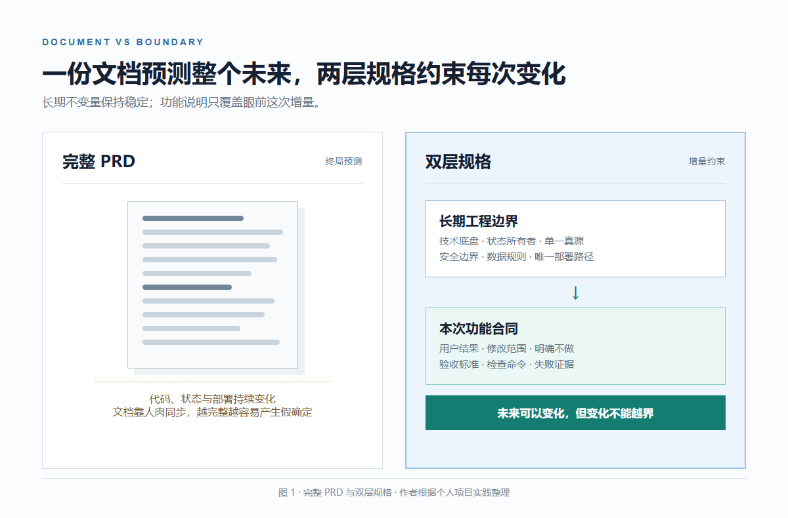
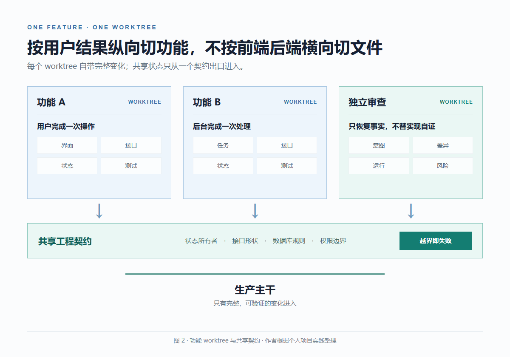
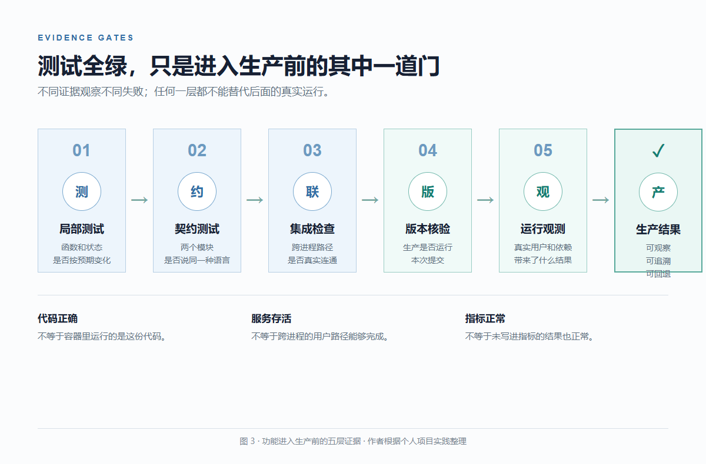
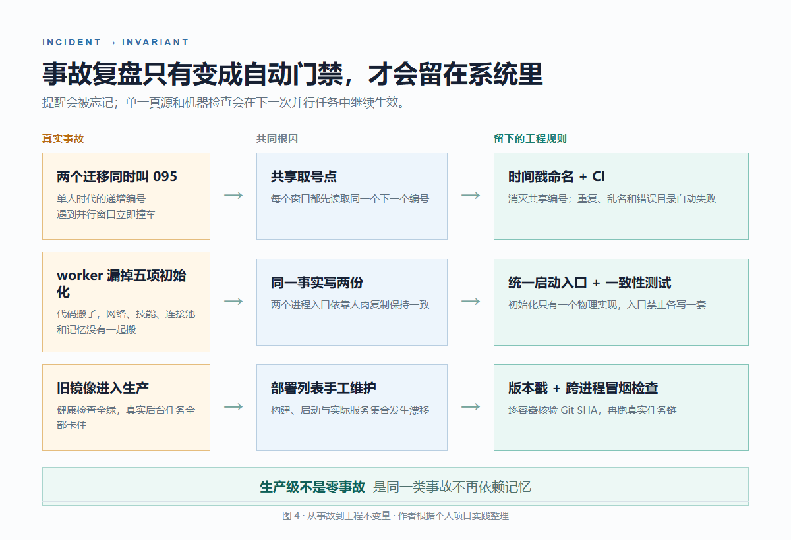

# AI 时代，详细的 PRD 还有必要吗？

我经常同时开着四五个 AI 编程窗口，开发同一个已经在线运行的项目。

一个窗口改会员系统，一个修编辑器，一个迁移后台任务，另一个专门检查前面几个窗口。它们会自己读代码、改前后端、补数据库迁移、跑测试。繁忙时，一天会消耗超过 10 亿 Token。

这种速度最危险的地方，是每个窗口都能很快写出一份单独看起来正确的代码。

有一次，新接口、队列和 worker 在仓库里都通过了测试。部署以后，所有请求却一直停在执行中，健康检查仍然全绿。

最后发现，部署脚本漏掉了新 worker 的镜像构建。仓库里的代码是新的，生产运行的却还是旧版本。

再完整的功能 PRD，也很难提前写下这种故障。它发生在功能、进程和部署系统的接缝处。

这让我重新思考：AI 时代真正需要写详细的，到底是什么？

**需求必须清楚，但不必用一份 PRD 预测产品终局。真正需要固定的，是工程边界、当前变化的验收标准，以及证明它已经安全进入生产的证据。**

这不是一个坏了可以重写的演示。项目已经接近三千个文件，前后端横跨 TypeScript 和 Python，容器编排里有十多个服务，还有 116 个数据库迁移和 571 个测试文件。

面对这样的项目和开发速度，我把原来的一份完整 PRD 拆成了两层：上层保存长期不变量，下层只描述眼前这一次变化。

完整 PRD 管的是已经想清楚的需求，工程边界管的是还没来得及想清楚的变化会扩散多远。

## 01 规格越重要，越不能把 PRD 当终局

这并不意味着规格不重要。恰恰相反，AI 越能独立写代码，越需要清楚的意图、技术约束和验收条件。

2025 年，GitHub 发布 Spec Kit，把开发拆成 Spec、Plan、Tasks、Implement 四个阶段。Kiro 也先生成需求、设计和任务，再让 Agent 实现。后来，Kiro 又增加了 Design-first 和 Bugfix Spec，因为既有项目里的工作不总是从新需求开始，有些从设计开始，有些从故障开始。

这些变化共同指向一个事实：AI 不会替我们拥有产品意图。描述留白，它就会用最常见、也最像正确答案的方案补全。

但规格重要，不等于一份覆盖终局的 PRD 会更可靠。

传统 PRD 主要解决人的串行协作问题。产品、设计、前端、后端和测试逐层传递信息，即使文档不完整，团队还有时间在评审、联调和测试中补齐。

AI 把这个过程压缩了。我还在确认一个交互，另一个窗口可能已经把数据库表、接口、前端状态和测试一起写完。等原来的假设被推翻，代码已经沿着它长出一整条路径。

METR 在 2025 年的一项研究里，让 16 位熟悉各自开源仓库的开发者完成 246 个真实任务。开发者觉得 AI 让自己快了 20%，实际完成时间却增加了 19%。这项研究讨论的不是 PRD，却提醒我们：**生成代码时感受到的速度，和把变化安全交付到真实系统的速度，是两回事。**

一个功能在纸面上可以独立，接进真实系统后却会碰到登录状态、旧数据、队列重试、第三方失败和部署顺序。很多边缘情况会在两个功能真正接上以后才第一次出现，开工前无法枚举。

比如，页面显示一笔订单已经成功，后台任务却还没完成发放。PRD 可以要求支付成功后增加权益，却很难提前列完重复回调、超时重试、前端轮询、退款和旧版本客户端同时出现时的全部状态组合。

继续往 PRD 里补场景，只会把文档变成另一个需要长期同步的系统。代码、数据库和部署方式不断变化，只要有一处没有更新，AI 就会读到几种互相冲突的真相。

**多窗口开发更危险的是认知冲突，Git 冲突反而容易被发现。**

Git 冲突会让合并停下来。认知冲突却可能顺利进入主干，只是两个窗口对同一个状态做出了相反的决定。

所以我没有停止写需求。我只是把稳定目标和当前变化分开记录，让长期不变量保持稳定，让每一次功能说明能够随真实反馈调整。

## 02 我先固定技术栈，不固定产品终局

长期不变量的第一层，是一套足够普通的技术底盘。

我的几个项目大多从相似的结构起步：前端用 TypeScript，后端用 Python 和 FastAPI，数据放 PostgreSQL，需要队列和短期状态时再用 Redis，服务通过 Docker 管理。

这些选择没有追求新奇。

它们的价值，是让不同窗口不用反复决定项目应该怎样启动、接口放在哪里、数据库怎样连接、日志从哪里看。

技术栈统一以后，新的项目仍然可以演进，但决策空间先被压小了。

真正固定得更死的，是状态和副作用的归属。

用户身份只能从一个认证入口变化。会员权益只能从一个计算点得出。模型调用只能走一个路由层。数据库结构只能从一份全量快照和对应的增量迁移演进。生产只能通过一条自动部署路径进入。

这些规则不是为了让架构图看起来整齐。

它们回答的是同一个问题：当一个窗口改错时，错误最多能传播到哪里。

项目里有一个能执行用户代码的隔离服务。它能访问哪些内部服务、能不能碰数据库、能不能拿到生产存储凭证，不能靠每个开发窗口临时判断。

这些访问关系直接写在网络拓扑和测试里。即使某个窗口完全误解了业务，它也拿不到边界之外的能力。

**可演进架构不是一开始画出终局。它是在系统暴露一个新的耦合点以后，把这个耦合点变成单一真源和自动门禁。**

所以项目的架构会越来越完整，却不是因为我在第一天已经想完。

它是从真实修改和真实事故里长出来的。

## 03 Worktree 隔离的是代码，工程边界隔离的是后果

长期边界确定以后，每个功能进入自己的 Git worktree。

一个 worktree 里包含这个功能需要的前端、后端、数据库变化和测试。任务完成以后，它作为一个完整变化接受检查，再决定是否回到主分支。

我不会把同一个功能拆成前端窗口、后端窗口和数据库窗口。

那仍然是传统流水线的切法。三个窗口修改的是同一条因果链，只是文件没有重叠。它们很容易各自通过测试，合起来却对不上。

我更愿意让一个窗口负责一个纵向结果。

比如，用户完成一次操作以后能看到确定状态，这个窗口就同时负责页面反馈、接口返回、状态落库和对应测试。另一个窗口可以处理完全不同的能力。

两边只通过已经存在的接口和状态契约连接。

这并不意味着建了 worktree 就完成了解耦。

**Worktree 只能防止两个窗口覆盖同一个文件，不能防止两个窗口对同一个状态做出相反决定。**

如果两个功能都要修改会员权益的计算方式，它们就不应该直接并行。

我会先把共享计算点收敛出来，让一个变化先进入主干。后面的功能只消费这个结果，不再各自计算一遍。

如果两个窗口必须同时碰同一个核心文件，通常也说明任务切错了。它们并不是两个功能，只是同一个功能被按文件名拆开。

工程边界要切断的是变化和故障的传播。

一个功能应该有明确输入，拥有自己的状态，通过显式结果连接外部。失败时也要给出确定结果，不能靠别的模块猜它进行到哪一步。

这样拆开以后，多窗口才从多人同时改仓库，变成几条可以独立验证的变化。

## 04 我不要求 AI 猜全边缘情况

每个 worktree 开始前，我会留一份很短的问题记录。

它不负责把功能写完整，而是记录用户现在遇到了什么、这次准备改变什么、哪些地方不能碰，以及什么结果可以证明它真的完成。

项目里有一次后台任务迁移。

原来在接口进程里执行的能力，被搬到了独立 worker。代码能启动，组件测试也通过，真实运行时却有五处能力同时消失：worker 连不到隔离服务，没有复用 HTTP 连接池，加载不到技能，长期记忆不再写入，密钥也不会定时刷新。

如果继续补 PRD，可以在文档里加五条提醒。

但这五个问题来自同一个根因：两个进程各自手写了一份初始化流程。

最后没有继续补五个判断。所有进程级初始化被收进一个入口，接口进程和 worker 只调用它。测试再检查两个入口有没有绕过这份单一实现。

这份问题记录的验收标准也很具体。

worker 必须能访问隔离服务，必须能看到正式技能，HTTP 连接池必须只初始化一次，还要通过真实后台任务生成一个文件。

这些结果里没有体验正常，也没有功能完整。

每一条都能通过命令、接口、数据库结果或真实产物观察。

**我不要求 AI 在开工前猜全所有边缘情况。我要求它把自己声称完成的结果，变成别人可以推翻的证据。**

测试的作用也因此发生了变化。

测试负责在每个边界上说明哪一种变化不允许发生，而不只是给代码盖章。

局部测试看函数，契约测试看两个模块有没有说同一种语言，集成检查走跨进程路径，部署核验确认生产正在运行这次提交，运行指标继续观察真实结果。

## 05 生产级稳定发生在代码写完以后

很多 AI 开发流程停在测试全绿。但测试全绿只说明仓库里的代码满足已经写下来的条件，不说明生产环境正在运行这份代码。

开头提到的旧 worker 事故，问题不在业务代码，也不在容器是否存活。构建服务的列表由部署脚本手工维护，新增 worker 出现在启动列表里，却没有进入构建列表。生产因此运行了一个健康但过期的进程。

后来，构建哪些服务不再由部署脚本手写，而是直接从容器编排配置得出。每个关键镜像写入当前 Git 提交号，部署后逐个核对。健康检查之外，再跑一次真实 worker 任务。

这几道门解决的不是同一个问题。

类型检查拦接口形状，数据库测试拦状态错误，服务边界测试拦越权连接，部署核验拦版本漂移，运行指标负责发现所有事先没写进测试的情况。

如果把它们都压成一个测试通过，反而会失去每层证据的含义。

我现在理解的生产级，不是代码里加满重试、回退和异常捕获。

它是从本地实现到真实运行之间，每一步都有清楚的失败信号，也没有任何一个窗口可以静默绕过这些信号。

## 06 每次事故最后都变成一条规则

多窗口并行以后，最先坏掉的是那些靠人记住的约定。

数据库迁移以前使用递增编号。一个人开发时，下一个文件取当前最大编号加一，几乎不会出错。

两个窗口同时创建迁移以后，它们都拿到了 095。

提醒 AI 创建前再检查一次没有用。两个窗口仍然可能在同一秒读取到相同状态。

最后，迁移文件改用创建时刻的秒级时间戳。测试自动检查命名是否合法、有没有重复、回滚脚本有没有误放进自动执行目录。

还有一次，服务拆分后出现五处初始化漂移。

最后留下的是统一启动入口和进程一致性测试，不只是一篇复盘。

旧 worker 镜像进入生产以后，留下的是镜像版本戳和跨进程冒烟检查。

这些规则看起来比 PRD 更低层。

但多窗口开发真正依赖的就是这些低层约束。

PRD 会过期，聊天记录会关闭，负责某个功能的窗口也会消失。单一真源、接口契约、测试和部署门禁仍然留在仓库里，下一次任务开始时继续生效。

这套方法没有让项目从此不出事故。

它只是让同一类事故不再依赖我和 AI 共同记住一次教训。

## 07 我的答案：要详细规格，不要终局 PRD

所以，AI 时代详细的 PRD 是必要的吗？

我的答案无法简单归为需要或不需要。

**需求需要更清楚，规格需要更可验证，但文档不需要假装自己已经知道产品终局。**

完整 PRD 仍然有它擅长的场景。

对外承诺的范围、付费规则、合规要求、跨团队职责和不可逆的数据迁移，都需要在动手以前写清楚。因为这些决定一旦进入现实，修改成本不只来自代码。

但功能怎样与现有系统交互，不会因为文档写得长就自动变成已知。

我的做法是保留少而稳定的产品目标，把系统级规则写进长期边界。每次功能变化只带一份增量说明和可执行验收，然后进入自己的 worktree。

合并以后，自动门禁继续检查它有没有破坏共享契约。部署以后，版本和运行结果继续提供证据。

繁忙的时候，多个 AI 窗口会在同一个项目里持续运行，一天消耗超过 10 亿 Token。

没有哪个窗口掌握整个系统，也没有哪份文档提前写全了当天会遇到的所有情况。

它们能同时工作，是因为每个窗口只拥有一个变化。

项目本身，拥有边界。

---

外部资料：METR《Measuring the Impact of Early-2025 AI on Experienced Open-Source Developer Productivity》；GitHub《Spec-driven development with AI》；Kiro《New spec types: fix bugs and build on top of existing apps》。
