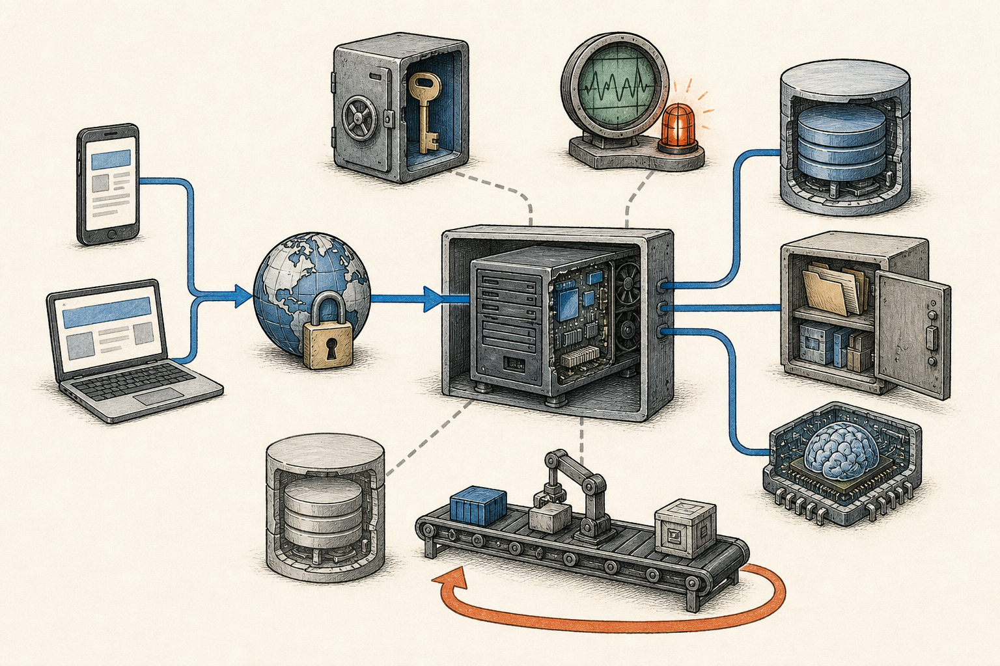

# AI 写的项目：从自己能用，到别人敢用

大多数人用 AI 开发项目时，最先看到的是一个可以操作的页面。

前端出现了，按钮能点击，提交以后也能返回结果，很容易让人觉得项目已经做完了。

AI 的确把这一步变得很快。过去需要几天搭出的页面和接口，现在几轮对话就能跑起来。

但按钮能点，只能说明最顺利的一条路径在当前电脑上跑通了。

它还没有回答这些问题：为什么换台电脑就启动不了？为什么把 localhost 发给别人，对方打不开？为什么部署到服务器以后需要域名、端口、Docker 和 Nginx？用户变多以后，应该先增加服务器、缓存，还是先处理数据库？

这些名词看起来像一堆互不相关的技术，其实它们都出现在同一条成长路线上。

**应用每向外走一步，就会失去一部分原本由开发者手工提供的保护，因此需要补上一层新的工程能力。**

这篇文章就沿着一条真实的路径，从 localhost 出发，一直走到可以承载大量用户的服务。

## 01 localhost 里到底运行了什么

先不急着上服务器。

一个 AI 生成的项目，通常从语言和框架开始。

浏览器最终认识的是 HTML、CSS 和 JavaScript。TypeScript 可以在写代码时检查数据类型，减少把数字、文字和空值混在一起的错误，最后仍然会被编译成浏览器能够执行的 JavaScript。

React、Vue 这类前端框架，则负责把页面拆成组件，管理界面状态，并组织页面之间的跳转。

如果项目还需要保存数据、验证用户身份或调用模型，通常还会有后端。

后端可以继续使用 TypeScript，也可以使用 Python。FastAPI、NestJS 这类后端框架，主要帮助我们组织网址对应的处理逻辑、检查输入数据，并把结果稳定地返回给前端。

**语言解决怎么表达，框架解决怎么组织。** 它们能让功能更容易开发，却不会自动让服务获得备份、监控和扩容能力。

当我们运行项目时，电脑里实际启动了一个或多个进程。

前端开发服务器可能监听 5173 端口，后端可能监听 8000 端口，数据库可能使用 5432 端口。数字并不固定，重要的是理解端口的作用。

可以把一台电脑看成一栋楼，IP 地址是这栋楼的地址，端口就是里面不同房间的门牌号。

浏览器访问 localhost:5173，意思是去当前这台电脑，找到 5173 号门后的程序。

localhost 永远指向访问者自己的电脑。因此把这个地址发给朋友，他访问到的是他的电脑，而不是你的项目。

本地项目之所以显得简单，是因为开发者同时承担了启动程序、保管密钥、查看错误和重试请求的工作。

## 02 从 localhost 到一个真正的网址

让别人访问，第一步不是增加更多框架，而是让程序离开个人电脑，运行在一台持续联网的机器上。

这台机器可以是云服务器，也可以由托管平台提供。

程序到了线上，还需要一条从网址通向程序的路。

用户输入域名以后，DNS 先把域名转换成服务器地址。HTTPS 加密浏览器与服务器之间的数据，并证明用户连接的是正确的网站。请求到达服务器后，再由正在运行的应用处理。

**第一版线上服务不需要复杂：一个应用实例、一个数据库，再加一处保存用户文件的对象存储。**

应用的环境变量由部署平台提供，进程意外退出后能够自动重启，数据库定期备份，日志能够被查看。这已经比在自己的电脑上运行多了最基本的公共服务能力。

刚开始时，优先使用成熟的托管平台通常更省心。平台已经代管了域名入口、HTTPS、进程重启和部分日志，我们不需要第一天就成为服务器管理员。

但托管不等于什么都不用理解。

当页面打不开时，至少要能判断问题发生在域名、证书、应用还是数据库；否则 AI 给出的每一种可能性看起来都同样合理。

## 03 为什么项目部署时会遇到 Docker

很多项目第一次上线都会遇到同一种情况：本地能跑，服务器上却跑不起来。

原因往往不是业务代码突然坏了，而是两台机器的环境不同。

本机可能装过某个系统工具，使用的是另一个 Python 或 Node.js 版本，终端里还保留着以前设置的环境变量。服务器缺少其中任何一项，启动结果都可能不同。

Docker 解决的是运行环境难以重复的问题。

它把程序需要的运行库、系统依赖和启动命令写进一份可重复构建的容器镜像。开发环境、测试环境和线上环境使用同一种打包方式，部署时就少一些凭记忆补环境的步骤。

可以把它理解成给应用准备了一个标准运输箱。箱子换了一艘船，里面的摆放方式仍然基本一致。

什么时候值得使用 Docker？

当项目需要在不同机器上重复部署、依赖系统软件、同时运行前后端和任务进程，或者希望以后更容易迁移平台时，它会很有价值。

什么时候可以先不用？

如果托管平台已经能根据项目配置稳定安装依赖、固定运行版本并启动应用，Docker 可能只是多出一层需要维护的构建文件。

Docker 也不会自动解决数据问题。

容器可以随时重新创建，因此数据库和用户文件不能只放在容器内部。真正需要长期保留的内容，要写进独立数据库、持久磁盘或对象存储。

**Docker 让应用更容易重建，但用户数据必须能够在应用重建以后继续存在。**

## 04 Nginx 为什么像服务器里的领路人

程序部署成功以后，可能出现新的问题。

一台服务器上，前端在 3000 端口，后端在 8000 端口，后台任务还有自己的管理入口。难道要让用户记住不同端口吗？

通常不需要。

浏览器访问网站时，默认走 HTTP 的 80 端口或 HTTPS 的 443 端口。Nginx 可以守在这两个公共入口，再把请求带到内部真正处理它的程序。

沿用门牌号的比喻，**服务器地址是一栋楼的位置，端口是房间号，Nginx 是大厅里的接待员。**

访问 example.com 的请求可以被送到前端，访问 example.com/api 的请求可以被送到后端。外部用户只需要记住一个域名。

这叫反向代理。

除了领路，Nginx 还可以处理 HTTPS 证书、静态文件、压缩、请求大小限制和基础限流。

但它也不是每个项目都要亲自安装的必选组件。

许多托管平台和云负载均衡器已经在入口处完成了同样的工作。只有在自己管理服务器、同一台机器运行多个服务，或者需要更精细地控制流量时，维护 Nginx 才更自然。

所以正确的问题不是项目上线后要不要补装 Nginx，而是谁正在负责 80 和 443 端口，以及怎样把请求送到正确的应用。

## 05 什么时候需要前后端分离

前端使用 TypeScript，不代表项目必须立刻拆成两个仓库、两套部署和两支服务。

对一个页面不多、交互简单的工具，全栈框架可以同时处理页面和少量后端逻辑。代码放在一个项目里，登录、类型和部署也更容易保持一致。

这通常是最小、也最稳的起点。

随着功能增加，前后端的工作节奏可能开始不同。

比如网页之外还出现了小程序或移动端，它们需要复用同一套数据接口；后端大量使用 Python 的模型与数据生态；AI 任务需要运行几十秒，不能和页面请求使用同一种处理方式；或者前端与后端需要独立发布。

这时把后端变成独立 API 服务才有明确价值。

前后端分离以后，双方通过接口协作。接口要约定输入字段、返回结构、身份验证、错误格式和版本变化。

这条边界如果没有写清楚，拆分只会把原来一次函数调用，变成一次更难排查的网络调用。

**前后端分离不是规模勋章，而是一条运行和协作边界。** 是否拆分，取决于有没有独立客户端、独立运行环境或独立发布节奏。

## 06 从几十人到几千人，先补工程底线

项目第一次迎来真实用户时，最容易做错的事情是立刻讨论高并发。

**几十、几百甚至几千名日活用户，并不一定需要复杂架构。**

如果大多数人只是偶尔读写一条数据，一个普通应用实例和一套托管 PostgreSQL 就可能运行得很好。相反，如果每次请求都要占用模型或 GPU 一分钟，几十个同时进行的任务就可能耗尽资源。

用户总数只是参考。更有用的指标是高峰期每秒有多少请求、一个请求占用多久、数据库做了多少工作，以及出错会造成什么后果。

有一个很实用的直觉：同时压在系统里的请求数量，大约等于每秒到来的请求数乘以平均处理时间。

同样是每秒 20 个请求，0.1 秒处理完和 5 秒处理完，对系统是完全不同的压力。

在这个阶段，最重要的不是增加 Redis 和微服务，而是补齐底线。

用户身份和权限要在后端检查；密钥不能写进代码；数据库要有备份并真正测试恢复；用户上传的文件要离开应用目录；发布失败要能退回上一版；错误日志和核心流程要能被监测。

如果 AI 生成任务时间很长，先给它设置超时、失败状态和重试规则。当用户必须一直开着网页等待，或者任务经常因网络中断而丢失时，再把任务放到后台队列。

早期服务的目标不是预先承载一百万用户，而是让前一百个用户遇到问题时，系统有记录、有保护，也有恢复办法。

## 07 从几千到几万，按瓶颈扩展

用户继续增加以后，不要凭感觉加入组件，**先观察哪一段真的接近上限。**

如果静态图片和脚本占用了大量带宽，可以使用 CDN，把不经常变化的文件放到更靠近用户的节点。

如果页面变慢，先查看数据库慢查询和索引。很多性能问题来自一次不必要的全表扫描，而不是服务器数量太少。

如果数据库连接经常用满，可以加入连接池，控制应用同时打开的连接数量。

如果同一批读取结果被反复计算，而且允许短时间内不是最新数据，Redis 这类缓存才开始有意义。缓存会带来过期、数据不一致和缓存失效的问题，因此不能只因为它快就使用。

如果邮件、文件处理或 AI 生成需要很长时间，或者流量会突然集中出现，可以用消息队列先接住任务，再由后台工作进程逐步处理。

队列也会带来重复执行、任务状态和失败重试问题。后台任务必须能够安全地再次执行，不能因为重试就产生两份结果。

当单个应用实例的 CPU、内存或并发连接在高峰期持续接近上限，或者一次发布不能再接受短暂停机时，才需要增加第二个、第三个应用实例。

多个实例前面需要负载均衡器分配请求。应用自身要尽量无状态：登录状态、任务状态和用户文件不能只存在某一台机器的内存或硬盘里，否则下一次请求被分配到另一台机器就会找不到。

**从单服务器走向多服务器，真正的变化不是机器数量，而是任何一台应用服务器都能够被替换。**

## 08 从几万到百万，数据库怎样演进

应用服务器通常比较容易横向增加，数据库更难。

因为应用实例可以复制，数据库里的每一份修改却必须保持正确。

所以数据库的演进往往比想象中慢，也应该更谨慎。

第一步通常不是拆成多个数据库，而是**先把一个数据库用好**：修正查询、增加必要索引、限制一次读取的数据量、使用连接池，并把数据库升级到更合适的规格。

当读取远多于写入，主数据库的读取压力确实成为瓶颈时，可以增加只读副本。主库负责写入，副本承担允许少量延迟的查询。

当单张表大到维护和查询都受到影响，而且数据有清晰的时间或业务边界时，可以考虑分区。

只有当单个数据库节点的写入、容量或故障边界经过优化后仍无法满足需要，才会走到分片：把不同用户或不同业务的数据放到不同数据库。

分片不是免费的扩容按钮。跨库查询、数据迁移、唯一编号和故障恢复都会更复杂。

同样，用户达到几十万或上百万，也不自动意味着必须使用微服务。

一百万注册用户可能只有几千日活；几万用户也可能在同一分钟集中执行重任务。真正要看的仍然是峰值并发、数据规模、可用性目标和团队协作方式。

当某个模块需要独立扩容、独立发布、使用完全不同的运行环境，或者已经由独立团队长期负责时，把它拆成服务才有收益。

在这之前，一个边界清楚的模块化单体，往往比几十个互相调用的小服务更容易维护。

## 09 架构不是按人数升级的

把这条路重新走一遍，会发现真正推动架构变化的，并不是注册用户刚好跨过了某个整数。

项目最初只有开发者自己，localhost 完全够用。这个阶段先把语言和框架选定，让项目可以用一条固定命令启动，远比考虑多台服务器更有意义。

当链接第一次发给别人，项目才迎来真正的转折。

程序需要离开个人电脑，拥有域名和 HTTPS；业务数据不能再跟着代码放在一起；即使开发者不守在终端前，程序也要能够重启、留下日志和恢复数据。

**第一次架构升级，不是从一台服务器变成两台，而是从只能靠开发者照看的电脑，变成一套可以被重建的线上环境。**

接下来，即使已经有几百或几千名日活用户，一个应用实例和一个数据库仍然可能运行得很好。

这时最有价值的建设，是知道用户等了多久、哪些请求失败了、哪条数据库查询最慢、后台任务有没有完成。没有这些信息，增加服务器只是在扩大一个看不清的问题。

再往后，系统会自己暴露短板。

静态文件拖慢访问，才把它们交给 CDN；相同数据被反复读取，才考虑缓存；长任务堵住正常请求，才增加队列和工作进程；单个实例在高峰期持续到达上限，才复制出更多实例。

当用户达到几万甚至更多，工作的重点也不是把所有东西拆开，而是缩小一次故障能够影响的范围。

应用实例可以随时替换，数据库有副本和恢复方案，发布能够逐步进行，重任务不会拖垮普通请求。此时的复杂度来自已经发生的问题，而不是对未来规模的想象。

即使到了百万级用户，注册人数本身仍然不能决定要不要分片、跨地域部署或拆微服务。

一百万个偶尔访问的账号，可能比几万个同时执行 AI 任务的用户更轻。只有现有数据库、机器或团队边界已经成为明确瓶颈时，下一次拆分才有意义。

更实用的判断其实很简单：如果现在删掉这个组件，眼前哪个问题会重新出现？

如果答不出来，就先不上。

因为每增加一个组件，不只是多了一项能力，也多了一个需要部署、监控、升级和排查故障的东西。

**好的架构不是组件最多，而是当前这套系统足够简单，也足够可靠，并且知道下一步为什么要变。**

AI 可以很快生成 Docker、Nginx、Redis 或 Kubernetes 的配置。真正需要人做的，是在它们还没有必要时忍住，在问题真正出现时又知道该往哪里走。

后面的系列会逐个拆开 DNS、HTTPS、Docker、Nginx、数据库、缓存、队列和监控。但不会从安装命令讲起，而会先讲它曾经解决了什么麻烦。先知道为什么存在，再决定自己的项目是否需要。

---

## 参考资料

- [MDN｜How the web works](https://developer.mozilla.org/en-US/docs/Learn_web_development/Getting_started/Web_standards/How_the_web_works)
- [TypeScript｜The TypeScript Handbook](https://www.typescriptlang.org/docs/handbook/intro.html)
- [FastAPI｜Features](https://fastapi.tiangolo.com/features/)
- [Docker｜What is a container?](https://docs.docker.com/get-started/docker-concepts/the-basics/what-is-a-container/)
- [NGINX｜Reverse Proxy](https://docs.nginx.com/nginx/admin-guide/web-server/reverse-proxy)
- [The Twelve-Factor App｜Config](https://www.12factor.net/config)
- [The Twelve-Factor App｜Processes](https://www.12factor.net/processes)
- [PostgreSQL｜Indexes](https://www.postgresql.org/docs/current/indexes.html)
- [PostgreSQL｜High Availability, Load Balancing, and Replication](https://www.postgresql.org/docs/current/high-availability.html)
- [Redis｜Client-side caching](https://redis.io/docs/latest/develop/clients/client-side-caching/)
- [OpenTelemetry｜Observability primer](https://opentelemetry.io/docs/concepts/observability-primer/)
- [OWASP｜Secrets Management Cheat Sheet](https://cheatsheetseries.owasp.org/cheatsheets/Secrets_Management_Cheat_Sheet.html)
- [Google Cloud｜Well-Architected Framework](https://docs.cloud.google.com/architecture/framework?hl=en)
- [Azure Well-Architected｜Simplify](https://learn.microsoft.com/en-us/azure/well-architected/reliability/simplify)
