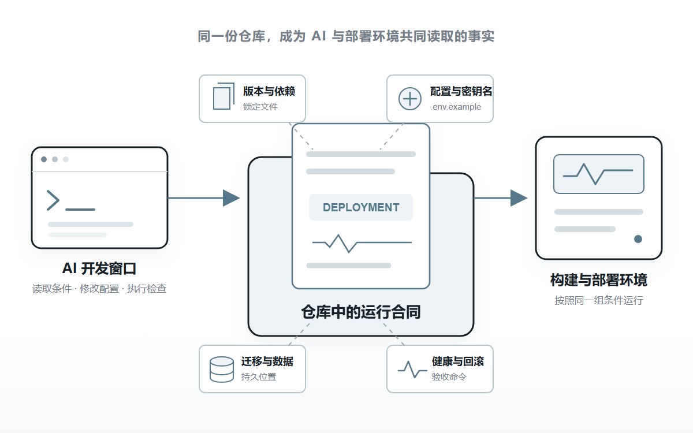
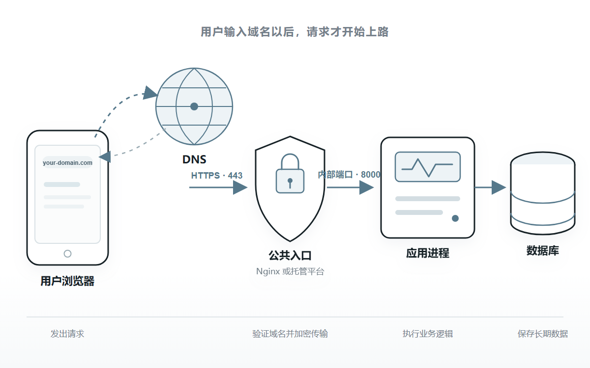
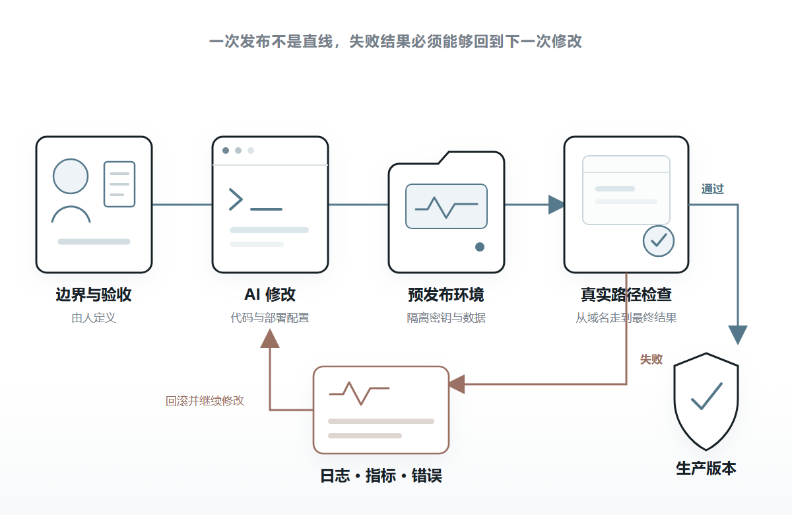

# AI 写的项目，怎么部署到网上给别人用？

很多人用 AI 做完项目，最后会补一句：帮我部署到网上。

几分钟后，仓库里多出一个 Dockerfile、一份 Nginx 配置和一份容器编排文件。AI 解释了每条命令，最后告诉你现在已经可以上线。

这些文件可能都没有语法错误，项目也可能真的启动了。

危险恰恰在这里。

一个纯静态页面，可能被套上数据库、缓存和五个容器。一个会保存用户文件的应用，也可能被放进随时重建的临时磁盘。模型密钥可能进了前端，健康检查可能只证明进程还活着，数据库却已经无法连接。

AI 不是故意把项目变复杂。它只是在补全没有写出来的部分。

它不知道哪些数据绝对不能丢，哪些端口可以公开，服务允许中断多久，发布失败以后要退回哪一版。它只能选择训练数据里最常见、看起来最完整的答案。

**AI 时代的部署，不是让 AI 多生成几份配置，而是把运行条件、权限边界和成功证据，变成它能够读取、执行和验证的系统。**

这套系统不必复杂。一个普通项目也可以从很小的结构开始。

## 01 AI 最擅长补全，部署最怕默认值

写页面时，AI 猜错一个颜色或间距，通常很快就能发现。

部署配置不同。

端口是否暴露、数据写在哪里、密钥由谁读取、数据库迁移什么时候执行，这些决定很多都藏在页面背后。配置看起来完整，不代表它满足当前项目的真实条件。

比如，把模型 API 密钥写进前端环境变量，代码仍然能够构建，页面也能调用模型。但前端代码最终会进入用户的浏览器，密钥仍然可以被提取。

再比如，AI 把上传文件写进应用目录。本地测试没有问题，第一次重新部署以后，平台重建运行环境，用户文件才一起消失。

这类错误很难靠一句生成生产级配置避免。

生产级不是一种固定模板。它取决于数据价值、故障影响、部署环境和维护能力。

OpenAI 在 2026 年发布的[工程实践](https://openai.com/index/harness-engineering/)里，把 AI 参与开发以后人的工作概括为设计环境、表达意图和建立反馈回路。人没有从工程里消失，只是从逐行写代码，移动到了定义边界和验证结果这一层。

对第一次部署来说，这意味着先回答几个不会由代码自动给出的事实。

项目是纯静态页面，还是需要后端进程？哪些内容需要长期保存？生产密钥允许谁使用？一次发布失败以后，能不能接受停机和数据回退？

这些答案确定以后，AI 才有足够信息选择部署方式。

**AI 可以负责实现部署，人仍然要拥有运行边界和成功标准。**

## 02 先把 localhost 写成一份运行合同

`http://localhost:3000` 只说明一件事：当前电脑里有一个进程，正在 3000 端口等待请求。

`localhost` 永远指向访问者自己的电脑。终端关闭，进程结束，这个地址后面就没有应用了。

要让另一台设备访问，程序需要换到一套持续联网的运行环境里。

问题是，下一次 AI 会话怎样知道这套环境需要什么？

只靠聊天记录不够。窗口会关闭，对话会压缩，新会话也没有参与以前的决定。

更稳定的做法，是把应用怎样运行写回仓库。

可以把这组信息理解成一份运行合同。它不是一种新的行业格式，也不必写成几十页部署手册，而是由几份短文档和可执行文件共同组成。

运行时版本进入 `.node-version`、`.python-version` 或容器基础镜像；依赖进入锁定文件；需要的配置名称进入 `.env.example`；数据库变化进入迁移脚本；构建、启动和检查命令进入自动化流水线或部署配置。

仓库还应该明确服务监听哪个端口，健康检查访问哪个地址，持久数据保存在哪里，发布失败怎样回到上一份已经验证的构建。

**真正的运行合同，不是描述系统应该怎样工作，而是让缺少任何条件时，构建或验收能够直接失败。**

OpenAI 的工程团队曾尝试把所有说明都塞进一份巨大的 `AGENTS.md`，后来发现内容会迅速过期，也很难机械验证。最后他们让短说明只负责提供地图，把架构、可靠性、安全和运行规则分别保存在仓库中，再用检查工具维持一致。

这对小项目同样成立。

AI 不需要一本百科全书。它需要一个短入口，能够继续找到当前任务真正相关的版本、命令、边界和验收方式。

## 03 先确定最小路径，再决定用什么组件

有了运行合同，下一步不是立刻选择 Docker 或 Nginx，而是先看用户的一次请求要经过哪里。

如果项目构建以后只剩 HTML、CSS、JavaScript 和图片，它是静态网站。文件进入静态托管，域名指向托管入口，通常就能完成第一次公开部署。

但只要项目需要登录、保存数据、调用不能暴露密钥的模型接口，或者执行浏览器无法承担的任务，它就需要后端。

这时最小路径通常是：用户输入域名，DNS 找到公开入口，HTTPS 保护连接，入口把请求交给应用端口，应用再读取数据库或对象存储。

Nginx 负责请求怎样进来。Docker 负责应用怎样被打包和运行。两者解决的不是同一件事，也都不是部署的必选按钮。

如果托管平台已经负责构建、HTTPS、请求入口和进程重启，小项目可以不维护这两层。

如果自己管理服务器，或者应用依赖系统软件、需要在不同机器上重复建立环境，Docker 会更有价值。同一台服务器运行多个服务，需要统一处理域名、证书和内部端口时，Nginx 才更自然。

这里真正需要固定的不是组件名称，而是谁负责每一层。

域名由谁解析，证书由谁续期，进程退出由谁拉起，数据库由谁备份，用户文件写到哪里。任何一项没有负责人，AI 生成再完整的配置也只是把空白藏了起来。

## 04 AI 不应该第一次就拿到生产环境

AI 可以快速修改配置，也能快速执行一条错误命令。

因此开发环境、预发布环境和生产环境不应该只靠名字区分。

它们需要真正不同的权限、密钥和数据。

开发环境可以使用本地数据库和测试密钥。预发布环境使用与生产相近的结构，但连接独立数据。生产环境只允许通过受控流程发布，不能让一次普通调试直接拿到全部凭据。

这不是因为 AI 一定会犯错，而是任何自动化系统都应该只获得完成当前任务所需的最小权限。

GitHub 的[部署环境](https://docs.github.com/en/actions/reference/workflows-and-actions/deployments-and-environments)就提供了这种边界：特定分支才能部署，环境密钥在通过保护规则后才进入任务，也可以要求人工批准。

普通个人项目不一定要照搬整套流程，但可以保留同样的结构。

AI 可以在独立分支和预发布地址里反复构建、迁移测试数据、打开页面和检查日志。只有已经通过验收的构建，才获得进入生产环境的机会。

生产密钥也不必先交给 AI，再要求它小心使用。部署平台可以在执行时注入密钥，AI 只知道需要哪些变量，不读取真实值。

**权限边界的作用不是提醒 AI 别做错，而是让错误发生时也到不了边界之外。**

## 05 没有反馈，AI 只能把猜测写得更像答案

很多部署流程停在容器已经启动或健康检查返回 200。

这只能证明某个进程愿意响应检查，不能证明用户真的能够完成一次操作。

数据库可能连不上，模型密钥可能无效，后台任务可能没有启动。应用仍然可以返回一个绿色的健康状态。

更可靠的反馈至少有三层。

最里面是进程检查，确认服务已经启动。中间是依赖检查，确认数据库、存储和必要的外部服务可以连接。最外面是真实路径检查，从公开域名发起一次最小操作，并验证最后的数据或文件确实产生。

发生错误以后，还需要留下足够线索。

日志至少要带时间、代码版本、请求标识、处理阶段和明确的错误原因，同时避开密钥与用户敏感内容。请求量、错误率和响应时间形成指标；服务变多以后，调用链可以记录一次请求经过了哪些组件。

[OpenTelemetry](https://opentelemetry.io/docs/concepts/observability-primer/) 将日志、指标和调用链归为理解系统状态的观测信号。对 AI 来说，它们还有另一层意义：这是模型能够读取的线上反馈。

OpenAI 的工程实践把浏览器、日志、指标和调用链直接接进 AI 的工作环境。于是低于某个启动时间、关键路径没有超时这类目标，不再依赖人截一张图描述，而能由 AI 查询和验证。

Anthropic 在[长任务执行环境研究](https://www.anthropic.com/engineering/harness-design-long-running-apps)中也发现，让外部检查者按照明确标准评价结果，比要求生成者自己保持怀疑更容易稳定。

这个方法不需要从安装一套庞大的监控平台开始。

第一版只要能够读取部署日志、识别当前运行版本，并通过一个脚本走完关键用户路径，AI 就已经从猜测线上发生了什么，变成可以依据反馈继续修改。

## 06 完成必须变成可以推翻的证据

部署完成不能只由执行部署的 AI 宣布。

它需要一组外部能够重复验证的结果。

**公网可达。** 开发者电脑关机以后，另一部手机使用移动网络仍然能够通过正式域名访问。

**能够恢复。** 主动结束应用进程或重启运行环境，服务能够自动回来，而不是依靠开发者重新打开终端。

**数据持久。** 创建一条测试数据并重新部署应用，数据仍然存在；用户上传的文件也没有跟随运行环境一起重建。

**密钥不外泄。** 前端构建产物、公开仓库和普通日志里找不到生产凭据，浏览器只能调用后端允许的接口。

**版本可确认。** 日志或版本接口能够说明生产环境正在运行哪次代码，而不是只看到几个绿色进程。

**失败可回退。** 部署一份无法通过关键路径检查的构建，发布流程会停止，或者恢复上一份已经验证的版本。

**备份能恢复。** 备份任务显示成功还不够，至少要实际恢复过一份测试数据，知道文件存在，也知道恢复步骤仍然有效。

这些验收不必在第一天全部自动化。

但每一项都必须有可观察结果。只要仍然只能回答应该没问题，它就还没有成为 AI 能够执行的工程规则。

**AI 时代的完成，不是一段可信的解释，而是一组别人可以重复执行、也可以推翻的证据。**

## 07 一个普通项目怎样最小落地

把上面的方法压回一个普通 AI 项目，第一版并不需要很多基础设施。

项目先在仓库里固定运行版本、依赖、构建命令、启动命令、环境变量名称、迁移方式和健康检查。AI 每次修改部署之前，都从这些事实开始，而不是重新猜一遍技术栈。

纯静态页面进入静态托管。带后端的项目可以先使用成熟托管平台，再接一套托管数据库；确实有用户上传文件时，增加对象存储。

每个代码分支先生成一个预发布地址。AI 在那里打开页面、调用接口、执行一条真实业务路径并读取日志。通过以后，同一份构建再进入生产，而不是在生产机器上重新手工拼一次环境。

生产发布完成后，流程记录代码版本，执行公网检查。失败时停止发布或退回上一版，错误信号再进入下一次 AI 修改。

如果以后迁移到自己管理的服务器，Docker、Nginx 和进程管理器可能加入结构。但运行合同、环境边界和验收脚本不需要重写，它们描述的是应用需要什么，不是某个平台的按钮在哪里。

如果服务在中国境内对外提供互联网信息服务，还要把备案和可能的业务资质放进上线计划。工信部门的[办事指南](https://hunca.miit.gov.cn/bsfw/bszn/art/2024/art_7ef0d8bd3b0d433ba4b9b277f883f74d.html)说明，境内非经营性互联网信息服务实行备案制度，经营性服务实行许可制度，部分内容还涉及前置审批。

这一阶段通常不需要 Kubernetes、微服务、消息队列和一组缓存服务器。

增加组件不会让 AI 自动理解系统，只会增加它需要部署、观察和排查的对象。

当一个新的 AI 会话进入仓库，它能够找到怎样构建、怎样运行、哪些权限不可越过、怎样证明部署成功；当线上结果不符合预期，它能够读取证据并回到上一份稳定构建，这个项目才真正拥有了 AI 时代的部署能力。

AI 生成代码和配置的成本已经很低。稀缺的是清楚的边界，以及能够证明结果的反馈。

---

## 参考资料

- [OpenAI｜Harness engineering: leveraging Codex in an agent-first world](https://openai.com/index/harness-engineering/)
- [Anthropic｜Harness design for long-running application development](https://www.anthropic.com/engineering/harness-design-long-running-apps)
- [RFC Editor｜RFC 6761: Special-Use Domain Names](https://www.rfc-editor.org/info/rfc6761/)
- [MDN｜How the web works](https://developer.mozilla.org/en-US/docs/Learn_web_development/Getting_started/Web_standards/How_the_web_works)
- [The Twelve-Factor App｜Port binding](https://12factor.net/port-binding)
- [The Twelve-Factor App｜Config](https://12factor.net/config)
- [The Twelve-Factor App｜Build, release, run](https://12factor.net/build-release-run)
- [GitHub Docs｜Deployments and environments](https://docs.github.com/en/actions/reference/workflows-and-actions/deployments-and-environments)
- [OpenTelemetry｜Observability primer](https://opentelemetry.io/docs/concepts/observability-primer/)
- [NGINX｜Reverse Proxy](https://docs.nginx.com/nginx/admin-guide/web-server/reverse-proxy)
- [Docker｜What is an image?](https://docs.docker.com/get-started/docker-concepts/the-basics/what-is-an-image/)
- [OWASP｜Secrets Management Cheat Sheet](https://cheatsheetseries.owasp.org/cheatsheets/Secrets_Management_Cheat_Sheet.html)
- [工业和信息化部｜互联网信息服务备案审批服务指南](https://hunca.miit.gov.cn/bsfw/bszn/art/2024/art_7ef0d8bd3b0d433ba4b9b277f883f74d.html)
