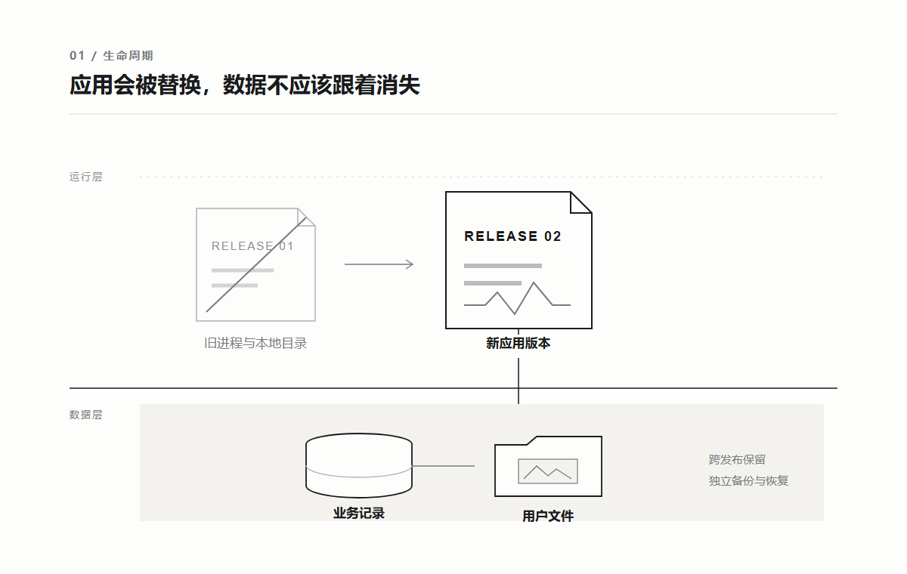
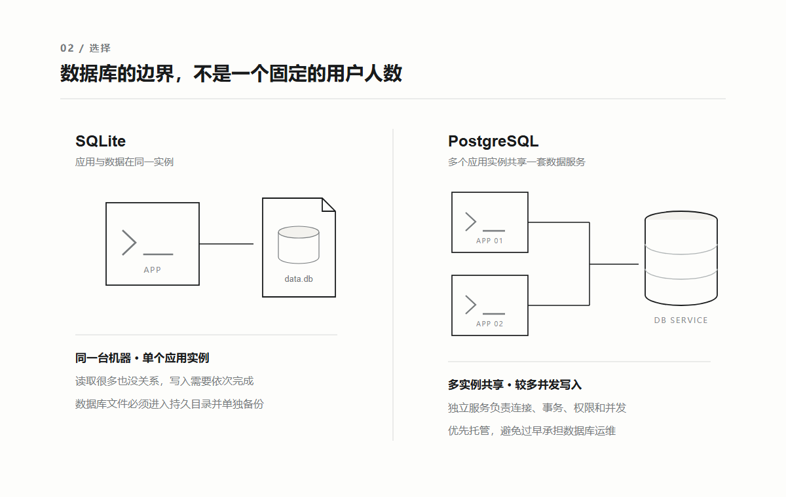
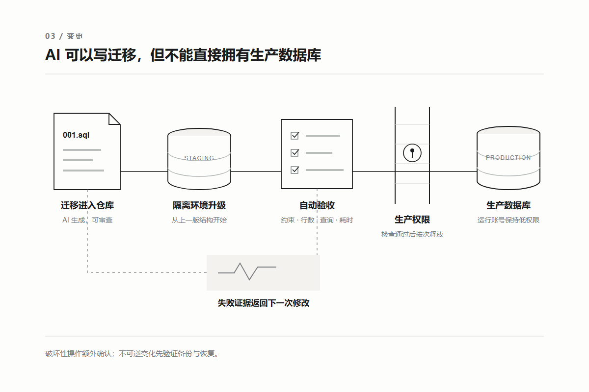

# AI 写的项目，数据到底该放在哪里？

很多人让 AI 给项目增加登录功能，它很快就会建一张用户表，再顺手接上 SQLite。

让它增加文件上传，它会在项目里新建一个 `uploads` 目录，把图片写进去。

本地测试通常没有问题。

注册、登录、上传、刷新页面，每一步都能成功。

直到项目第二次部署。

运行环境被重新建立，用户记录和上传文件一起消失。

开发者开始怀疑部署平台、Docker 或数据库不稳定，但真正的问题更早就出现了。

AI 在没有数据边界的情况下，选择了最短的可运行路径。

页面代码丢了，可以从仓库重新构建。

用户数据丢了，仓库里没有第二份。

**代码应该能够被替换，用户数据必须拥有独立于代码的生命周期。**

这不是 AI 时代才出现的原则。

传统软件用了几十年建立数据库、备份、权限和变更制度，都是为了守住这条边界。

真正改变的是速度。

过去一周发生一次的数据库变更，现在 AI 几分钟就能生成；过去由 DBA 和发布窗口拦住的操作，现在一段指令就可能直接执行。

所以 AI 时代需要的不是更多数据库，而是把传统工程里的数据纪律，变成 AI 能读取、验证，却不能随意越过的系统。

## 01 传统软件先保护数据，再替换程序

传统项目并不是一开始就有微服务、分库分表和庞大的数据库团队。

个人软件常把数据放进本地文件或 SQLite；早期网站常用一台应用服务器和一套 MySQL、PostgreSQL；业务重要以后，才逐渐增加备份、只读副本、故障切换和专门的数据库管理员。

不同规模背后有一个共同结构：程序和数据被当成两种不同的东西。

程序是可替换的构建产物。

发布新版本时，可以停止旧进程、换成新文件，失败后再退回上一版。

数据是持续累积的业务状态。

订单、余额、权限关系和用户内容不能跟着程序一起回退，更不能因为换了一台服务器就从头开始。

关系数据库之所以长期成为业务系统的默认选择，不只是因为它能保存表格。

它用主键、唯一约束、外键和事务保护业务关系。

一次操作需要同时修改多条记录时，事务可以让它们全部成功，或者全部不生效。

[PostgreSQL 对事务的定义](https://www.postgresql.org/docs/current/tutorial-transactions.html)就是把多个步骤组合成一个不可分割的操作。

传统企业还会把数据变更和普通代码发布分开管理。

开发者提交结构变化，DBA 检查锁表时间、索引、容量、备份和回退方案，再在发布窗口执行。

生产应用使用受限账号，建表、删列等操作交给权限更高但更少使用的账号。

这套方式不总是高效。

简单变化可能要经过很长的审批；人工在生产环境执行 SQL，也可能让真实结构与仓库记录不一致；有些团队会在还没有流量时就提前设计分片、双机和异地容灾。

但它保留下了三条不能丢的原则：**数据有明确的事实源，结构变化留下记录，破坏性操作需要更高权限。**

AI 时代应该替换缓慢的人工传递，不应该删掉这三条原则。

## 02 AI 加快的不是数据库，是变更频率

AI 很容易看见一段代码需要什么，却很难仅凭代码知道数据意味着什么。

它看见一个 `status` 字段，可以帮你改名、补索引或换成枚举。

但它不知道其中某个值是否对应已经履约的订单，也不知道删除一列会不会让两年前的数据无法解释。

更麻烦的是，AI 生成的改动往往同时跨过页面、接口和数据库。

一个新增会员等级的需求，可能在一次任务里改完表结构、后台逻辑、前端展示和部署配置。

代码生成速度提高了，数据风险也从偶尔一次人工操作，变成每个开发窗口都可能发生的普通改动。

因此，数据库不能只存在于正在运行的服务器里。

仓库至少要保存当前结构、迁移顺序、关键约束、测试数据生成方式，以及哪些数据不能被删除或带出生产环境。

可以把它们合在一起理解为一份数据合同。

它不要求再写一份几十页文档。

表结构和约束由迁移文件表达，敏感级别与保留规则写在短说明里，关键业务条件由测试和检查脚本表达。

例如，订单号必须唯一，已完成订单必须关联用户，一次迁移前后的有效订单数量不能减少。

这些条件不能只写在提示词里，而要在 AI 执行以后自动检查。

OpenAI 的 [Harness Engineering 实践](https://openai.com/index/harness-engineering/)把仓库知识作为系统事实源，并用检查工具维持规则。

对数据库来说，同样的思路就是让 AI 从仓库读取结构和边界，而不是每次重新推测生产数据。

**传统时代靠人记住数据不能怎么改，AI 时代要让不允许的改动无法直接通过。**

## 03 先分清四种数据，再决定放在哪里

数据库选型之前，先看数据的生命周期。

第一种是临时状态。

页面构建缓存、可以重新生成的临时文件、一次请求中的中间结果，即使丢失也不会改变业务事实。

它们可以进入内存或临时磁盘。

第二种是结构化业务记录。

用户、订单、会员关系、任务状态和权限，彼此之间存在明确关系，需要查询、约束和事务，通常进入 SQLite、PostgreSQL 这类关系数据库。

第三种是二进制对象。

图片、视频、音频、PDF 和压缩包适合进入对象存储。

数据库保存文件属于谁、当前状态、对象键和校验信息，而不是把文件随手写进应用目录。

第四种是派生数据。

缩略图、搜索索引、统计汇总和向量表示都可以从原始数据重新生成。

它们可以使用专门的存储，但必须知道自己的来源，也必须允许被重建。

这四类数据最重要的区别，不是文件格式，而是丢失以后能否恢复。

Docker 官方文档说明，容器默认写入自身的可写层；容器被删除时，这一层不会继续保留。

托管平台上的运行实例也经常会随着发布和扩缩容被替换。

因此，应用目录可以保存一次运行需要的临时内容，却不能默认承担用户数据的长期保存。

**凡是无法从代码或其他事实源重建的内容，都不应该只存在于可重建的运行环境里。**

这个判断还解决了一个常见混乱。

日志不是业务数据库，缓存不是事实源，向量索引也不应该成为原始文档唯一的存放位置。

每一层都可以丢，但必须知道能从哪里重新得到。

## 04 SQLite 还是 PostgreSQL，不要按用户人数猜

很多文章喜欢给出一条简单门槛：几百人用 SQLite，几千人换 PostgreSQL。

这个判断不可靠。

十万个人每天读取一份公开数据，压力可能很低；二十个人同时抢库存、修改余额，数据一致性已经很重要。

真正需要观察的是数据在哪里、由多少个进程写、能不能排队，以及应用是否需要多台实例共同访问。

SQLite 不是玩具数据库。

它把完整数据库保存在一个文件里，不需要单独运行数据库服务，部署、复制和备份都很直接。

SQLite 官方甚至强调，它竞争的对象不是 PostgreSQL，而是应用自己读写普通文件。

当应用与数据在同一台设备或同一台服务器上，写入不密集，只有一个应用实例负责访问时，SQLite 往往是很好的最小实现。

它允许多个读取者同时工作，但同一时刻只有一个写入者。

多数短事务可以排队完成；如果大量请求需要同时写入，或者多个服务器要通过网络共享同一份数据，客户端与服务器分离的数据库更合适。

[SQLite 官方选型说明](https://www.sqlite.org/whentouse.html)也把并发写入和数据是否跨网络作为主要边界。

PostgreSQL 更适合公开的多人在线服务。

它由独立服务管理连接、事务、并发与权限，多个应用实例可以共同访问。

使用托管 PostgreSQL 时，备份、升级和故障处理还能由平台承担一部分，个人开发者不必先成为数据库运维人员。

但 PostgreSQL 不是项目显得正式的装饰。

一个只在本机使用的工具，为了连接远程数据库而增加网络、账号、证书和服务费用，反而扩大了故障面。

选择可以压缩成三个问题。

数据是否只跟一台设备或一个应用实例一起运行？是否只有少量并发写入？是否能够可靠备份那个数据库文件？三个答案都是肯定，SQLite 可以继续使用。

只要需要多实例共享、较多并发写入，或者不希望自己维护数据库进程，就自然进入托管 PostgreSQL。

## 05 数据库、对象存储和缓存，各自只做一件事

选定主数据库以后，不要急着继续增加组件。

结构化业务记录留在关系数据库。

它擅长按条件查询数据、维护关系和保证一次业务操作的一致性。

用户上传的文件进入对象存储。

以 Amazon S3 为代表的对象存储使用存储桶和对象键管理文件，对象还可以带元数据和访问权限。

应用可以通过受限接口上传，或者生成有时间限制的签名地址，不必让文件先经过应用服务器再永久留在那里。

数据库里只保存对象键、所有者、大小、类型、校验值和业务状态。

删除一条业务记录时，也要有清理对应对象的流程，避免数据库和文件各自留下孤儿。

缓存解决的是重复计算或重复读取太慢。

如果一份 Redis 数据丢失会让订单消失，它就已经被错误地当成主数据库。

缓存应该能够从数据库或其他事实源重新填充。

向量也是派生数据。

原始文档、分段方式、所用模型和版本信息应该保留，向量索引才能在模型升级或切分规则变化后重建。

项目已经使用 PostgreSQL 时，可以先在同一套数据库里增加向量能力；只有数据量、查询延迟或隔离需求真的超过现有方案，才值得引入独立向量服务。

这也是 AI 时代很容易被忽略的成本。

AI 可以在一分钟内接入 Redis、对象存储和向量数据库，但从此以后，每个环境都要配置它们，每次发布都要检查连接，每次故障都多出一个排查方向。

**一个好的数据架构，不是能接多少存储，而是每类数据只有一个清楚的事实源。**

## 06 AI 可以写迁移，但不能直接拥有生产数据库

数据库结构一定会变化。

传统团队用变更单和 DBA 控制风险；AI 项目更适合把变化写成按顺序执行的迁移文件。

增加字段、创建索引、回填数据和删除旧结构，都应该进入仓库。

任何新环境都能从空数据库建立到当前版本，已有环境也能从上一版本沿着同一条路径升级。

迁移文件解决记录问题，却不会自动让变化安全。

例如把一列直接改成非空，旧记录可能没有值；重命名字段以后，正在运行的旧版本还在读取旧名字；给大表创建索引，也可能长时间占用资源。

更稳妥的方式是把破坏性变化拆开。

先增加新字段，让新旧代码都能工作；再回填历史数据并检查结果；等所有运行实例都切到新结构以后，下一次发布才删除旧字段。

这通常被称为 expand、migrate、contract。

它的价值不是多了三个术语，而是让代码发布和数据变化不必在同一秒完成。

AI 可以生成这几步，也可以在隔离数据库里从上一版结构开始执行迁移，比较行数、约束、关键查询和耗时。

通过以后，部署流程才允许迁移账号进入生产。

日常运行账号只保留查询和修改业务数据所需的权限，不拥有删库、删表或改变结构的权力。

OWASP 的数据库安全建议同样强调最小权限，并要求开发、测试和生产使用独立数据库与账号。

GitHub 部署环境一类机制还可以把生产密钥放在保护规则之后，未经批准的任务读取不到它们。

这里的人机边界应该非常明确。

AI 可以设计和验证迁移，自动化流程可以执行已经通过检查的迁移；删除字段、批量覆盖数据、降低约束等不可逆操作，仍然需要额外确认和可恢复的备份。

**不要靠提示词要求 AI 小心，要让普通开发权限根本做不了破坏性操作。**

数据库迁移失败以后，也不一定应该立刻反向执行所有操作。

删除字段后再回滚代码，旧数据不会自己回来。

对已经写入新数据的系统，修正后继续向前通常比机械回退结构更安全。

真正不可逆的变化，需要在执行前完成备份、验证恢复，并把删除动作延迟到确认无人使用以后。

## 07 普通 AI 项目的最小数据方案

把前面的原则落到一个普通项目，最终需要的东西并不多。

只在个人电脑运行、数据量不大、写入不密集的工具，可以使用 SQLite。

数据库文件放进明确的持久目录，退出程序和更新版本以后仍然保留，并定期复制到另一处位置。

开始向多人提供在线服务时，可以直接选择托管 PostgreSQL。

应用与数据库使用网络连接，生产连接信息由部署环境注入，不进入前端和代码仓库。

出现图片、音视频或大文件上传，再增加对象存储。

数据库保存文件的业务信息，对象存储保存实际字节。

缓存、独立搜索、专用向量数据库和分片，都等到现有结构出现了可以测量的问题以后再加入。

仓库里至少留下六样东西：当前数据结构说明、按顺序执行的迁移文件、测试数据生成方式、环境变量名称、备份与恢复步骤、迁移后的验收脚本。

AI 修改数据相关代码时，先从这些事实开始。

它可以创建一个隔离数据库，执行全部迁移，生成测试数据，再从上一生产版本升级到当前版本。

验收也不应该停在数据库连接成功。

重新部署应用以后，原有记录和文件仍然存在；两个请求同时修改同一份关键数据时，结果没有互相覆盖；普通用户读取不到其他用户的数据；生产日志没有输出敏感字段；备份可以恢复到一套独立环境；当前结构版本能够被确认。

这些证据通过以后，数据变更才算完成。

AI 时代的选型其实比传统时代更需要克制。

代码和接入组件变得太容易以后，增加复杂度几乎不再需要付出开发成本，但运行、迁移、备份和恢复的成本并没有消失。

SQLite、PostgreSQL 和对象存储已经能覆盖绝大多数早期项目。

先让数据知道自己是谁、应该活多久、丢失后从哪里恢复，再考虑下一种基础设施。

**AI 可以重新生成整个应用，但它无法重新生成用户曾经交给你的数据。**

---

## 参考资料

- [OpenAI｜Harness engineering: leveraging Codex in an agent-first world](https://openai.com/index/harness-engineering/)
- [SQLite｜Appropriate Uses For SQLite](https://www.sqlite.org/whentouse.html)
- [Docker Docs｜Storage](https://docs.docker.com/engine/storage/)
- [PostgreSQL｜Transactions](https://www.postgresql.org/docs/current/tutorial-transactions.html)
- [PostgreSQL｜Backup and Restore](https://www.postgresql.org/docs/current/backup.html)
- [PostgreSQL｜pg_restore](https://www.postgresql.org/docs/current/app-pgrestore.html)
- [Amazon S3｜Objects overview](https://docs.aws.amazon.com/AmazonS3/latest/userguide/UsingObjects.html)
- [OWASP｜Database Security Cheat Sheet](https://cheatsheetseries.owasp.org/cheatsheets/Database_Security_Cheat_Sheet.html)
- [GitHub Docs｜Deployments and environments](https://docs.github.com/en/actions/reference/workflows-and-actions/deployments-and-environments)
