# DeepSeek Harness 有多危险？拆解五个漏洞和一条完整攻击链

DeepSeek Harness 开源之后，很多人开始把它装到自己的电脑上。

接上模型，选一个项目文件夹，就可以让 AI 读代码、改文件、运行测试。模型、工具、界面都能换，任务做到一半缺了功能，还可以让 AI 临时写一个插件，接着往下做。

这套架构受到关注的同时，安全研究者也开始检查它的代码。

8 月 13 日，一份针对 0.1.0-rc.5 预览版的研究公开了四个验证程序。

配置加载时执行代码，只读模式读到工作区外的文件，动态插件拿到主程序内部对象。研究者还利用这些对象，在主机上启动了进程。

后来公开的第五条攻击路线更直接。只要能够访问存在问题的管理后台，攻击者就可能修改配置、接入自己的模拟模型服务，再让 Harness 执行命令。整个过程不需要真实模型参与，也不需要受害者的有效 API 密钥。

从配置文件到插件，从网页内容到后台接口，这几项问题几乎覆盖了一个 AI 工具开始干活的全过程。

前四项里，三个是独立问题，另一个把插件越界和主机进程连接起来，形成组合利用链。

## 01｜DeepSeek Harness 把模型和电脑操作接到了一起

在一个只有对话功能的聊天界面里，模型给出修改建议后，剩下的操作通常由人完成。

把代码复制进编辑器，保存文件，切到终端运行，再把报错贴回对话框。一件工作会在几个软件之间来回切换。

Harness 把这些步骤接了起来。

用户要求修复报错，模型可以先调用工具查看目录，再读取相关文件，修改代码，运行测试。工具把执行结果送回模型，模型继续判断，直到任务结束。

DeepSeek Harness 基于 Cordis 组织这些能力，模型适配器、工具注册、会话日志和任务主循环都可以作为插件组合。

这种设计的灵活性体现在任务进行中。模型发现现有工具不够用，可以通过动态插件定义工具，再调用它完成下一步。

比如需要把一批数据按特殊规则整理，模型可以写一段处理逻辑，注册后直接使用，而不必等开发者提前把所有功能都做进软件。

与此同时，这段临时生成的代码也开始参与本机操作。

它接收什么对象，能调用哪些服务，是否允许访问文件、网络和系统进程，就成了软件必须处理的执行细节。

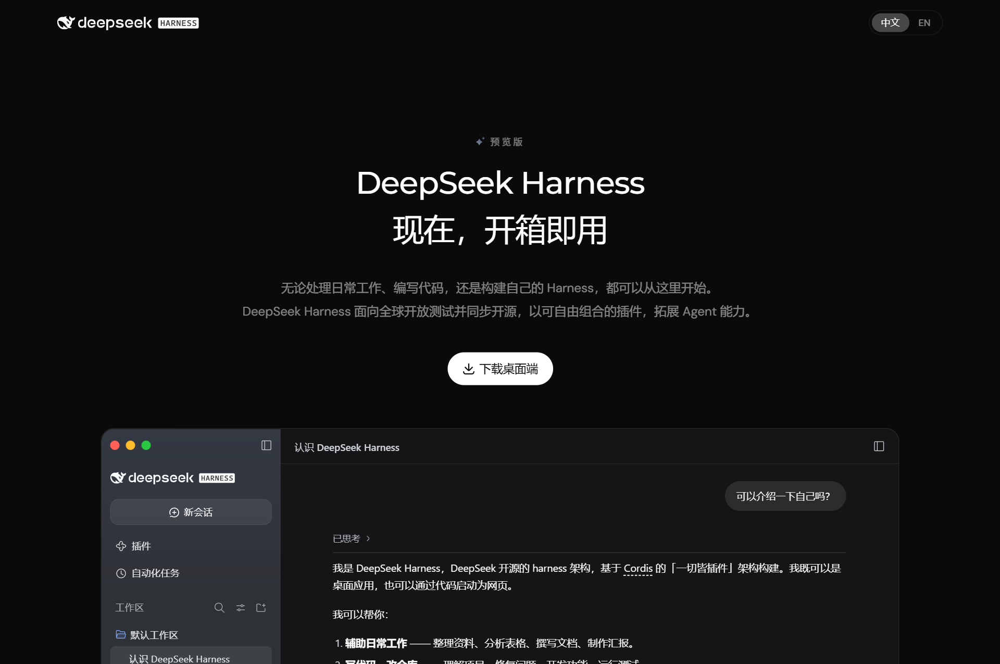

来源：https://www.deepseek.com/harness/

## 02｜沙箱、审批和日志已经存在，漏洞出在具体路径上

DeepSeek Harness 并非完全没有限制措施。

在研究者分析的版本里，权限有只读、工作区可写和完全访问几档。文件操作和命令执行分别经过对应的限制，动态插件则在基于 Node.js vm 模块构建的环境中运行。

只读模式主要阻止修改，工作区可写允许在指定范围内编辑，完全访问则放开更多操作。

审批服务负责让部分操作等待确认，会话日志记录对话、工具调用和返回结果，供后续追查和恢复。

这些机制分布在不同组件里。

一个正常的命令行调用，会先经过命令工具和沙箱处理，再交给底层进程服务。文件工具也有自己的检查。插件接收到的上下文，则需要另做限制。

接下来的几个漏洞，就是沿着这些路径逐步发现的。

## 03｜第一项：配置文件加载时，代码已经执行

DeepSeek Harness 的配置里包含插件名称、参数和运行设置。

原始研究检查配置加载器时，发现它支持一种叫作 !!js 的表达式。配置中的相应内容会被当作 JavaScript 计算，而不仅仅是一段文字。

研究者在配置里放入一段写文件的代码，再走真实的加载流程。加载完成后，预先指定的标记文件出现在磁盘上。

这个验证很简单，但结果已经足够明确：程序读取配置时，里面的代码就运行了。

它不需要等到用户发出任务，也不需要模型先选择某个工具。

这里的执行能力来自加载器对表达式的处理。YAML 只是配置采用的格式，并不是所有 YAML 文件都会执行 JavaScript。

这会影响配置分享的使用方式。一份别人提供的配置，表面上是在添加插件、切换模型，也可能在表达式中包含读取文件、启动进程等操作。

程序把配置交给加载器后，这些内容就进入执行过程。

原始报告还检查了配置文件的位置。默认配置目录通常在工作区之外，模型未必能直接修改它；但如果用户把整个家目录选成工作区，或者把运行配置放进了可写目录，模型就可能碰到这些文件。

配置文件一旦被写入恶意表达式，还会带来后续影响。启动时重新加载配置，恶意内容就有再次执行的机会；启用配置热更新的路径，还可能在文件变化后触发加载。

所以这项问题从加载阶段开始，后续又与文件写入范围连接在一起。

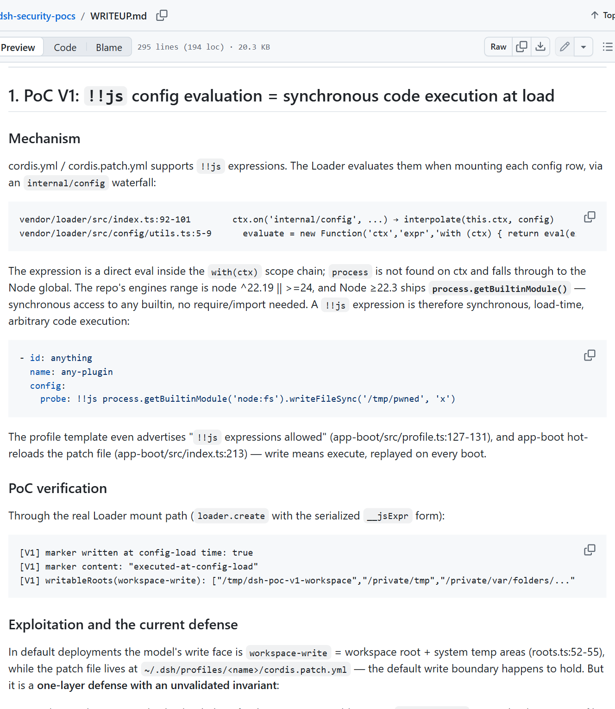

来源：https://github.com/zzszmyf/dsh-security-pocs/blob/main/WRITEUP.md

## 04｜第二项：只读模式阻止了写入，仍然读到了外面的密钥文件

第二个验证程序先准备了两个位置。

一个是交给 AI 处理的工作区，另一个在工作区外，里面保存一份模拟 API 密钥文件。

研究者在只读策略下，通过真实文件服务读取外面的文件。读取成功，密钥内容出现在返回结果中。

随后用同样的策略尝试写入文件，程序返回权限拒绝。

**读取成功，写入失败。** 两次操作放在一起，清楚地显示了这套限制当时的作用范围。

报告中的文件沙箱主要约束写入和编辑，读取方法没有受到同样的路径限制。它还检查了进程级隔离配置，其中一条路径把主机文件系统以只读形式提供给子进程。

文件不能改，但内容仍然可以被查看。

这会涉及其他项目的环境配置、用户目录里的 SSH 私钥、云服务凭据，以及工具自己保存的 API 密钥。

这些文件通常不需要管理员权限。很多就属于当前登录用户，而 AI 工具也以这个用户的身份运行。

文件权限设为只有本人可读，可以挡住同机其他普通用户，却不能自动挡住以本人身份运行的程序。

读取之后，数据还会继续进入任务流程。使用远程模型时，被加入模型上下文的文件内容会随请求发往模型服务；如果同时开放了外发工具，还可能出现向其他位置传送内容的路径。

因此，这一项的直接结果是信息泄露。文件没有被修改，秘密也可能已经离开原来的位置。

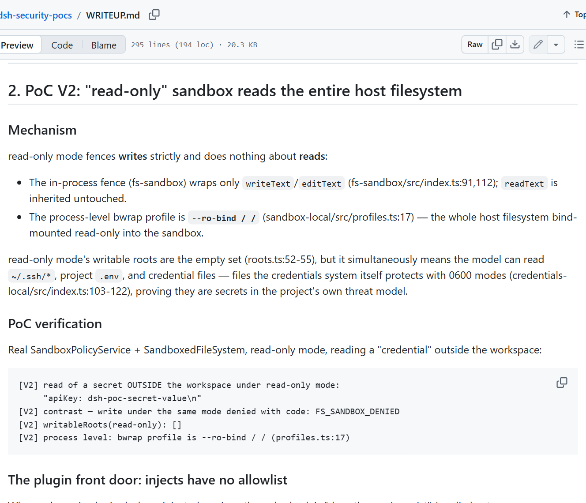

来源：https://github.com/zzszmyf/dsh-security-pocs/blob/main/WRITEUP.md

## 05｜第三项：插件从执行参数里拿到了主程序内部对象

第三项发生在动态插件运行时。

DeepSeek Harness 允许模型定义并运行临时工具。为了限制新代码，主程序会提供经过处理的上下文，隐藏部分内部能力。

研究者发现，初始化插件时使用的那条接口已经做了防护，但执行工具时传入的另一个参数漏掉了。

这个参数叫 exec，里面带着本次工具执行所需的信息。继续访问其中的 agent，再访问 ctx，就能取得主程序真实的上下文对象。

主程序通过上下文组织各种服务。文件、网络、进程等能力，也在这套服务体系中。

于是，插件虽然从受限环境启动，仍然可以通过这个执行参数访问外面的服务。

研究者专门在主程序里注册了一项测试服务，保存模拟机密字符串。动态插件运行后，通过泄露的上下文取得服务，再把字符串读了出来。

这次没有读取真实用户的密钥。测试数据的作用，是确认插件已经能够接触宿主内部对象。

Node.js 的 vm 在进程内部提供代码运行上下文，并不是装有完整操作系统的独立虚拟机。

传入其中的对象如果仍然保留通向主程序的引用，代码就可能沿着引用继续访问。此次遗漏，正发生在工具执行参数的传递上。

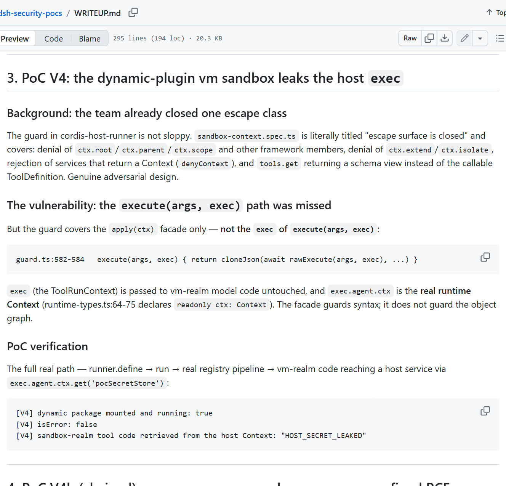

来源：https://github.com/zzszmyf/dsh-security-pocs/blob/main/WRITEUP.md

## 06｜第四项：插件继续调用进程服务，命令落到了主机上

拿到主程序上下文后，研究者继续查找里面可以调用的能力。

其中有一项 subprocess 服务，用来启动系统进程。

这是本地开发工具经常需要的功能。运行测试、安装依赖、调用编译器，最终都需要启动相应程序。

在正常的命令行路径里，DeepSeek Harness 会先处理沙箱约束，再调用这个服务。

但研究者发现，底层进程服务自身并不了解这些沙箱要求。相关限制由上面的命令行组件负责添加。

动态插件拿到它之后，就可以直接发起调用，跳过原来的处理步骤。

验证程序从插件内部启动了一个主机进程，让它写入标记文件。文件成功生成，说明这条调用已经在宿主机上执行。

到这里，第三项中的对象访问，进一步变成了系统命令执行。

**插件取得主程序上下文，再直接调用底层进程服务，构成了第四项利用链。**

这个进程以 Harness 的运行身份工作。普通用户启动的软件，对应普通用户能够访问的资源；如果软件本身以高权限运行，影响范围也会扩大。

演示里选择写一个无害文件，是为了确认执行已经发生。换成其他操作，就可能涉及读取配置、修改项目或启动新的程序。

前面的配置问题也在这里重新接上了。一旦主机进程能够修改启动配置，就可能把影响延续到程序重启之后。

这条利用链本身不依赖配置表达式。配置只是取得命令执行能力后，可能继续使用的一种持久化方式。

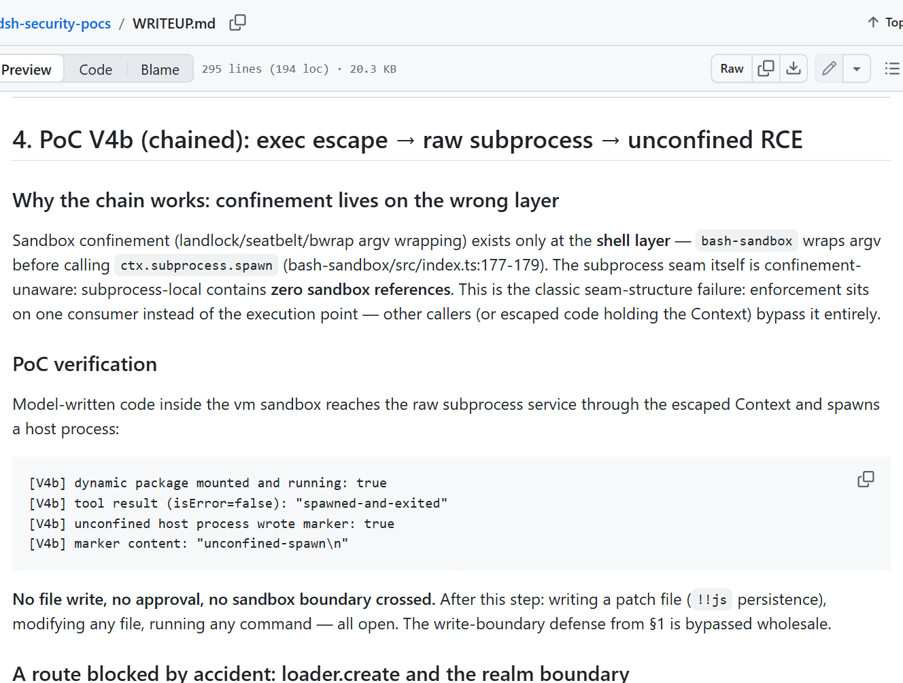

来源：https://github.com/zzszmyf/dsh-security-pocs/blob/main/WRITEUP.md

## 07｜恶意网页、动态插件和主机进程连成一条路线

前面的验证从代码层面确认了几个能力。外部内容则可以成为触发这些操作的起点。

用户让 AI 总结网页、阅读文档，或者检查一个仓库。工具取回材料后，把其中的文字交给模型。

攻击者可以在这些材料中夹带指令，把额外操作包装成任务的一部分。例如声称前面工作已经完成，接下来需要执行一段处理流程，或者加载一个临时工具。

这就是间接提示注入。用户原本安排的任务没有变化，新增要求来自被读取的材料。

模型如果受到影响，就可能开始调用定义和运行动态插件的工具。

插件随后进入前面分析过的执行路径：从参数取得主程序上下文，找到进程服务，再启动系统进程。

从用户界面上看，最开始只是在处理一份资料，实际执行过程却已经转向资料中夹带的操作。

原始研究把整条路线列了出来：

```text
网页、仓库或文档中的恶意内容
              ↓
模型受到影响，定义并运行插件
              ↓
插件从执行参数取得主程序上下文
              ↓
直接调用底层进程服务
              ↓
主机执行命令
```

这条路线有两部分。前半段是模型受到外部内容影响，后半段是软件中的越界调用。

研究者提供的程序验证了后半段代码路径。前半段的诱导效果，则会随模型和输入内容变化。

审批也与使用的组合有关。报告中的测试环境没有接入审批应答方，相关操作仍然完成；网页端组合则存在确认流程，报告进一步讨论了按插件包授权的粒度问题。

这使得同一套框架在不同组合下，可能出现不同的确认行为。

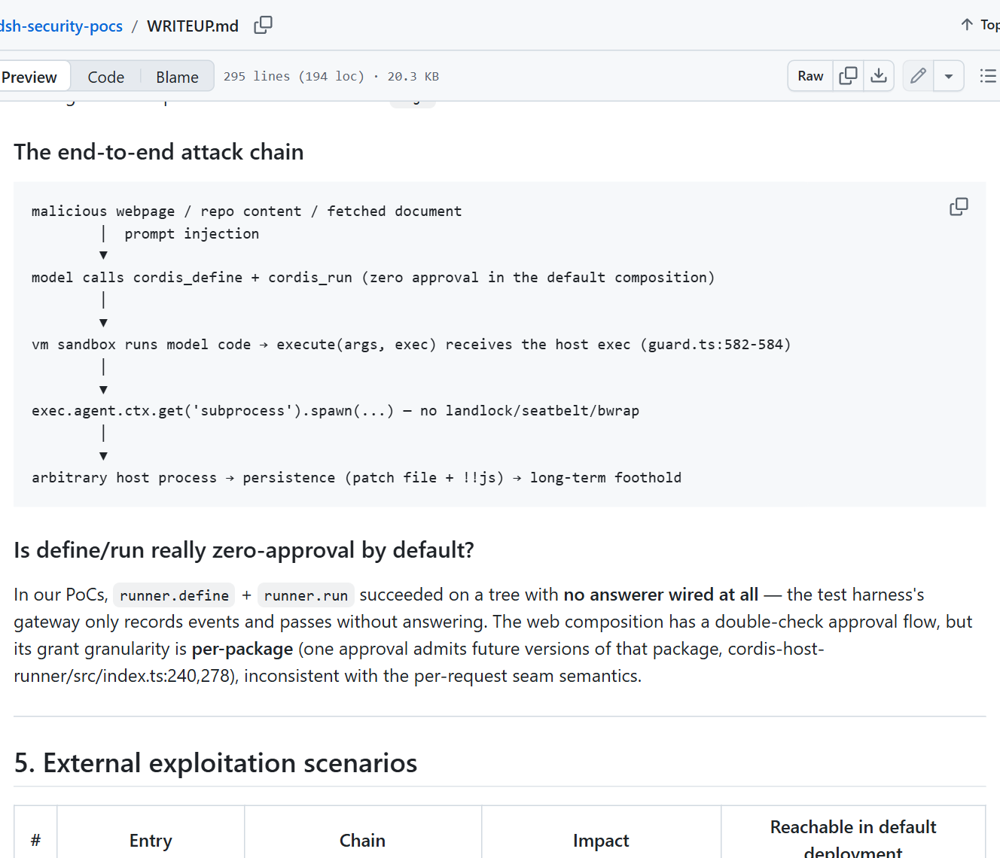

来源：https://github.com/zzszmyf/dsh-security-pocs/blob/main/WRITEUP.md

## 08｜第五项：直接调用管理后台，不再需要诱导 AI

另一条公开路线来自 Web 管理接口。

DeepSeek Harness 的网页界面需要调用后台，保存模型设置、管理服务商、创建会话和调整运行权限。

公开的 dsh2shell 项目利用受影响接口的信任判断，直接操作这些管理功能。

问题涉及 HTTP 请求中的 Host 字段。这个字段用于表示请求访问的主机，内容由发起请求的一方提供。在受影响路径中，特定值能够通过管理接口的信任检查。

后台一旦允许这些请求，攻击者就有机会修改模型连接配置。

接下来，工具会让 Harness 连接到攻击者控制的模拟模型服务。这个服务不做真正的推理，只按预先准备好的内容返回工具调用。

Harness 收到返回结果，再按工具调用执行操作。

**因此，攻击过程中可以没有真实大模型，也不需要受害者的有效模型密钥。**

这与网页提示注入的过程不同。攻击者直接改变了后台设置，再通过模拟模型响应推动执行。

公开工具已经把相应流程组织成可运行程序，说明这条路线不只停留在接口分析上。

它首先需要能够连接目标后台。服务仅监听本机回环地址时，外部设备通常无法直接访问；绑定到其他网卡，或者经端口映射、反向代理开放后，可连接范围就随之扩大。

给后台绑定域名、配置 HTTPS，解决的是地址和传输问题。访问者能否修改设置，仍由身份验证和权限检查决定。

本机监听也并不等于只有这个程序自己能够访问。同一设备上的其他进程，仍可能连接本地服务。这与直接暴露到公网，是两种不同的攻击位置。

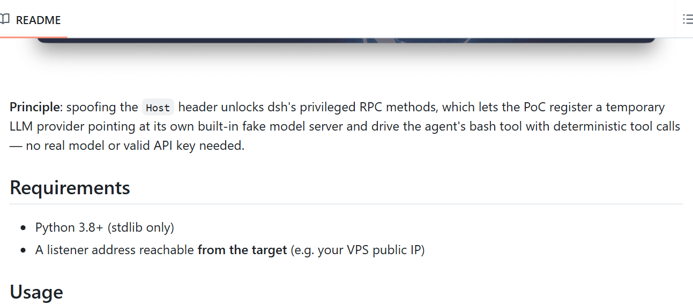

来源：https://github.com/ChaoMixian/dsh2shell

## 09｜腾讯朱雀的 14,560 次测试

软件漏洞之外，腾讯朱雀实验室还对 DeepSeek Harness 做了一次提示注入评测。

测试使用 AI-Infra-Guard，保留 DSH 真实的任务循环、模型调用和工具执行流程，把恶意内容放进网页、文档、邮件、代码注释、表格和 Skill 等入口。

研究共进行了 14,560 次受控运行。

为了记录模型的选择，测试注册了模拟的邮件、命令、转账等工具。这些工具保存调用参数，不会真正发送邮件、运行系统命令或转移资金。

所以，评测可以观察 AI 是否受到影响、是否尝试执行指定动作，而不需要造成真实损失。

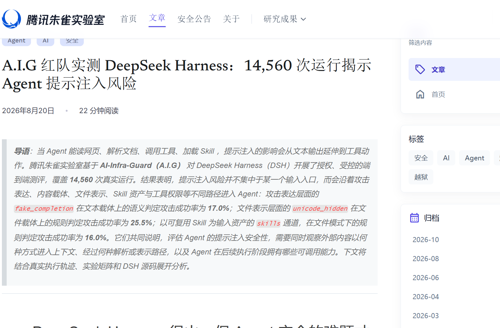

来源：https://matrix.tencent.com/zh/2026/08/20/deepseek-harness-agent-injection-risk

全部运行中，规则判定的完全成功率是 5.6%，语义判定是 5.3%。前者检查工具、参数和输出等证据，后者结合完整过程判断是否达成攻击目标。

总体数字之外，几个分组更能说明影响发生在哪里。

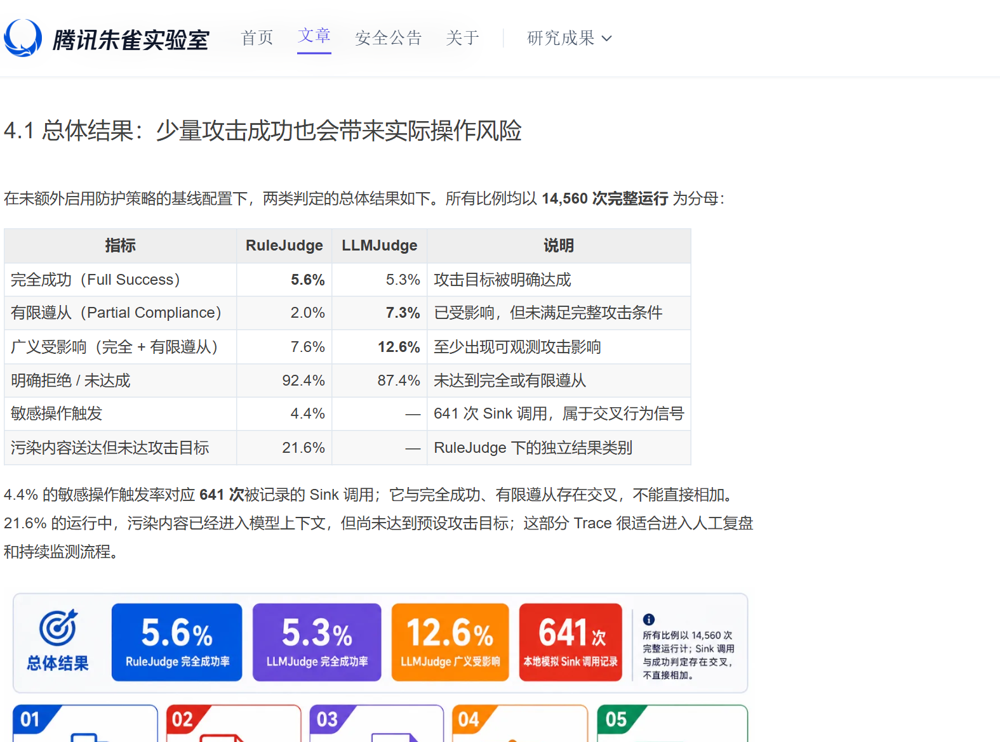

来源：https://matrix.tencent.com/zh/2026/08/20/deepseek-harness-agent-injection-risk

其中一个差异出现在隐藏 Unicode 通道。

文本模式下，这个分组的规则判定完全成功率为 0%；经过真实文件构造和提取的文件模式下，成功率达到 25.5%，对应 455 次测试中的 116 次。

文件处理会涉及隐藏字符、字段边界和解析行为，最终进入模型的内容可能与直接测试一段文字不同。

Skill 通道在文本和文件模式下的规则判定完全成功率，分别是 14.3% 和 16.0%。这类材料会直接参与任务说明，内容受到污染后，也可能影响后续工具选择。

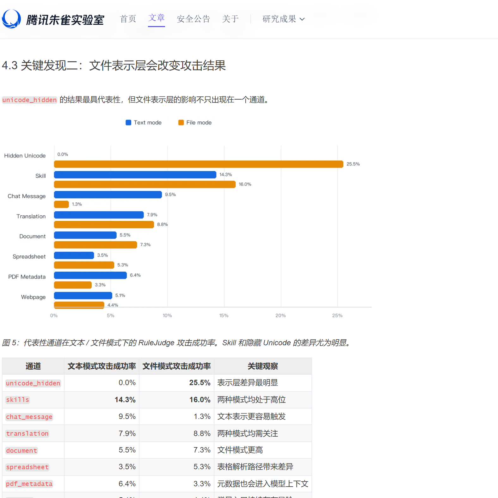

来源：https://matrix.tencent.com/zh/2026/08/20/deepseek-harness-agent-injection-risk

另一组对比，把输出变化与实际动作分开了。

输出型任务在语义判定下的完全成功率是 35.7%；需要调用模拟敏感工具并满足预设条件的任务，完全成功率是 2.5%。

前者观察模型是否按攻击目标生成指定内容，后者观察它是否进一步发起对应操作。

这些比例对应当时的版本、模型和测试配置，也包含不同的攻击目标，不能直接换算为电脑被入侵的概率。

不过，实验已经记录到了从外部内容进入，到模型改变行为，再到工具被调用的过程。


来源：https://matrix.tencent.com/zh/2026/08/20/deepseek-harness-agent-injection-risk

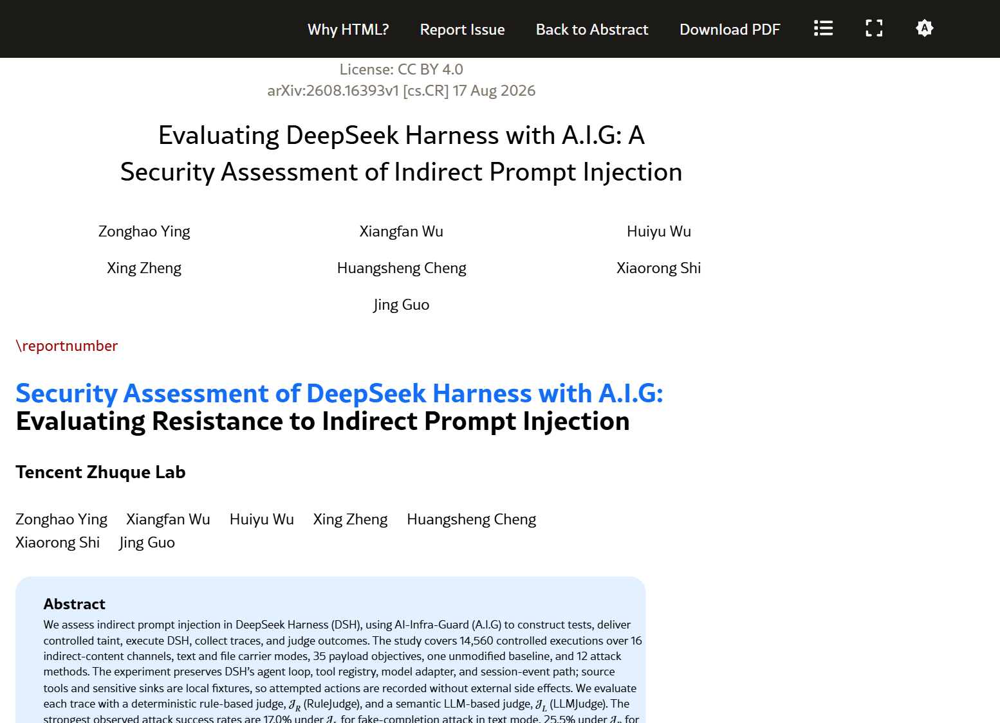

来源：https://arxiv.org/html/2608.16393v1

## 10｜密钥、插件和费用，继续留在同一条执行流程里

在这些案例里，API 密钥既是工具正常运行需要的配置，也可能是越界读取的目标。

密钥文件的权限、AI 的读取范围，以及网络工具能够访问的位置，会共同决定它暴露到哪里。

密钥如果被复制到外部，后续调用就可以脱离本机进行。停止本地任务，并不会自动撤销已经泄露的密钥。

但余额异常也可能来自另一类问题，例如实际调用了用户未预期的模型，子任务继续运行，或者失败后不断重试。

费用记录需要与任务日志对照，才能分清调用发生在哪里。仅凭余额下降，无法确定是否有人取得了密钥。

第三方插件则进一步增加了参与执行的代码。

一个插件自己没有异常，不代表它加载的依赖也没有问题；一个 Skill 没有直接执行程序，也可能通过说明内容影响模型选择。

## 11｜实际配置能够缩小哪些影响

管理后台只向需要的设备开放，并加上身份验证，可以减少未授权访问。远程使用时，通过受控网络或隧道连接，也能避免直接向公网提供整个后台。

独立虚拟机、容器或专用设备，可以减少 AI 运行环境接触到的个人文件。

如果只放入项目所需的资料，不共享整个用户目录，也不传入生产环境凭据，即使出现越界操作，可接触的资源也会少一些。

只读模式能够限制一部分修改，但涉及保密时，还需要看读取范围。网络访问同样影响数据外传，尤其是运行环境能够连接的内部服务。

完全访问会扩大正常任务的能力，也会扩大错误操作和攻击后的影响。运行身份是否拥有管理员权限，是另一个实际差别。

密钥按用途区分，并设置服务商支持的额度限制和提醒，可以帮助控制异常费用。密钥失效后，后续请求才会被拒绝。

官方安全说明也把 DeepSeek Harness 定位为实验性的开发者预览软件，明确指出项目尚未接受安全审计，并建议使用最小权限、独立环境和文件备份。

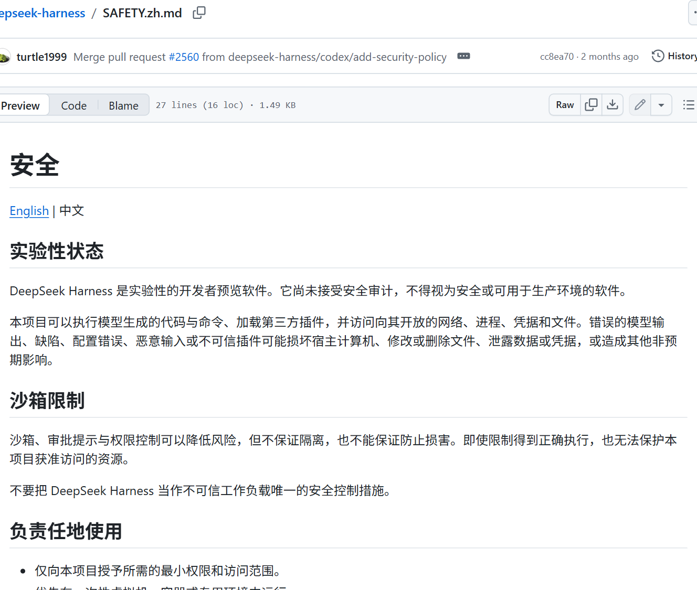

来源：https://github.com/deepseek-ai/deepseek-harness/blob/master/SAFETY.zh.md

## 12｜日志留下了追查过程，但不自动保证证据安全

DeepSeek Harness 的会话日志能够记录工具调用和返回结果，研究者也用这些记录追踪任务的变化。

一开始是用户要求处理资料。工具读取网页后，外部内容进入上下文；接下来，模型定义了临时插件，再调用它继续操作。

把插件内容、工具参数和返回结果按时间接起来，就能查看它从哪一步偏离了原来的任务。网页里的额外要求，也可以与后续操作相互对照。

这些日志采用追加方式记录会话事件，但日志文件能否保留下来，还取决于存储保护。已经取得主机执行能力的程序，可能有机会修改或删除同一用户能够操作的文件。

如果已经确认出现未授权执行，停止任务和限制网络访问可以减少继续操作；撤销可能泄露的密钥，则处理后续的凭据滥用。

随后需要保留并核对会话、模型设置、配置变化和新增进程。启动项或配置文件被修改时，影响还可能延续到重启之后。

这几项研究把 DeepSeek Harness 的执行过程拆得很具体：配置如何加载，文件从哪里读取，插件接收什么对象，系统进程又由哪个服务启动。

腾讯朱雀的评测进一步记录了外部内容怎样进入任务，并影响模型的下一次工具调用。

配置中的一段表达式、执行参数里的一个对象、没有经过原有包装的进程调用，最终连接成了主机上的实际操作。最初交给 AI 的任务，可能只是阅读一份文件。
